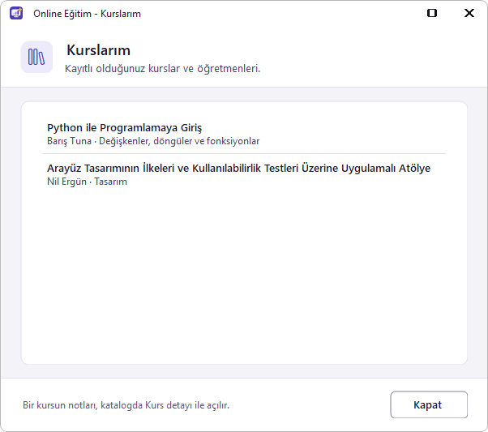

# 🎓 Online Eğitim Platformu

Bu proje, **C#** kullanılarak geliştirilen bir **Online Eğitim Platformu** uygulamasıdır. Öğrenci ve öğretmen rolleri için ayrı paneller içerir ve kullanıcıların kurslara erişmesini, kurs detaylarını görüntülemesini ve içeriklerle etkileşim kurmasını sağlar.

---

## 🚀 Kurulum ve Başlatma

Projeyi çalıştırmak için aşağıdaki adımları takip edin:

1. **Gereksinimler:**
   - .NET 10 SDK ve bir **SQL Server** örneği (ör. SQL Server Express).

2. **Bağlantı Ayarını Yapın:**
   - `src/OnlineEgitim.UI/appsettings.example.json` dosyasını aynı klasörde `appsettings.json` adıyla kopyalayıp bağlantı cümlesindeki **sunucu adını** kendi ortamınıza göre düzenleyin
     (bu dosya git'e eklenmez). Alternatif olarak `EGITIM_CONNECTION` ortam değişkenini veya `dotnet user-secrets` kullanabilirsiniz.

3. **Projeyi Başlatın:**
   - `dotnet run --project src/OnlineEgitim.UI` komutunu çalıştırın ya da çözümü Visual Studio ile açın.
   - Veritabanı ilk çalıştırmada EF Core migration'larıyla otomatik oluşturulur. Eski uygulamanın veritabanı varsa veriler korunarak yerinde yükseltilir.
     Kimliği belirsiz kayıtlar (eksik, boşluklu veya yinelenen ad/e-posta, OgrenciID ve DersID dışında sütun içeren kayıt anahtarı, mükerrer ders kaydı)
     yükseltmeyi hiçbir değişiklik yapmadan durdurur; hata penceresi ve günlük yalnızca sorun türünü ve sayısını gösterir. Kayıtları düzeltip uygulamayı yeniden başlatın.

4. **İlk Öğretmen ve Kurulum Anahtarı:**
   - Hazır hesap yoktur. Veritabanı **tamamen boşsa** uygulama **İlk Kurulum** ekranıyla açılır ve ilk öğretmen anahtarsız oluşturulur.
   - Kurulum anahtarı yalnızca **şifreyle giriş yapabilen hiçbir öğretmen yokken** kabul edilir:
     öğrencileri olan ama öğretmeni olmayan veritabanında ilk öğretmen (girişteki **İlk öğretmen kurulumu (kurulum anahtarı)** bağlantısı),
     yalnızca şifresiz öğretmenleri olan veritabanında bir öğretmene ilk şifre (**Şifresiz hesabı kurtar** → **Öğretmen (kurulum anahtarı)**) ve
     hiçbir derse kayıtlı olmayan şifresiz bir öğrenciye ilk şifre (aynı ekranda kod yerine anahtar). Şifreli bir öğretmen varken anahtar kabul edilmez.
   - Anahtarı **yalnızca veritabanı sahibi (db_owner/DBA)** üretir: `sqlcmd -S <sunucu> -d <veritabanı> -E -i docs\issue-setup-key.sql`.
     Betik `CRYPT_GEN_RANDOM` ile 128 bitlik anahtarı bir kez gösterir (32 onaltılık karakter), veritabanına yalnızca SHA-256 özetini yazar;
     anahtar **24 saat** geçerlidir ve **bir kez** kullanılır. `@RevokeUnusedKeys = 1` önceki kullanılmamış anahtarları iptal eder. Uygulama anahtar üretemez.
   - Anahtar hesap değişikliğiyle aynı veritabanı işleminde tüketilir: yazma başarısız olursa anahtar yanmaz; tüketilen anahtar başka bir Windows
     profilinden veya bilgisayardan yeniden kullanılamaz. Yanlış denemeler anahtarı kilitlemez veya iptal etmez (her ret küçük, sabit bir bekleme ile döner);
     anahtar günlüğe veya açık metin olarak veritabanına yazılmaz.
   - `EGITIM_SETUP_KEY` ortam değişkeni yalnızca formdaki anahtar alanını doldurur; değer veritabanındaki kayda karşı doğrulanır, tek başına yetki vermez.
     Biçimi geçersizse (tire ve boşluklar atıldıktan sonra 32 onaltılık karakter değilse) form yapılandırma hatası gösterir.
   - **Uygulama bağlantısının yetkisi:** İlk çalıştırma (migration) veritabanı sahibinin bağlantısıyla yapılır; sonra uygulama için ayrı bir login
     kullanılması önerilir. `docs/grant-app-login.sql` örneği bu login'e hesap ve ders tablolarında okuma/yazma, `KurulumAnahtarlari` tablosunda ise yalnızca
     `SELECT` ve `Tuketildi`/`TuketimTarihi` sütunlarında `UPDATE` hakkı verir; anahtar ekleme, silme, özet veya son kullanma değiştirme reddedilir.

5. **Şifresiz Eski Hesapların Kurtarılması:**
   - Eski uygulamada şifresi boş kalan hesaplar boş veya herhangi bir şifreyle giriş yapamaz; hesap kimliği ve ders kayıtları korunarak şifre şöyle belirlenir:
   - **Öğrenci:** Öğretmen panelindeki **Kurtarma Kodu Üret** ile, yalnızca o öğretmenin kendi derslerinden birine kayıtlı öğrenci için tek kullanımlık,
     24 saat geçerli bir kod üretilir (veritabanında yalnızca özeti tutulur). Başka öğretmenin öğrencisi veya derssiz öğrenci için istek, öğrenci yokmuş gibi
     reddedilir. Öğrenci girişteki **Şifresiz hesabı kurtar** bağlantısında adını, kodu ve yeni şifresini girer. Hatalı kodlar giriş kilidine sayılır.
   - **Öğretmen:** Aynı bağlantıda **Öğretmen (kurulum anahtarı)** seçilir; şifresiz öğretmen hesabına kurulum anahtarıyla bir kez şifre belirlenir.

English: first teacher, setup key and recovery

- An **empty** database opens the first-run setup; the first teacher is created without a key.
- A setup key is accepted only while **no teacher can sign in with a password**: for the first teacher of a database that has students,
  for the first password of a teacher without one, and for a passwordless student enrolled in no course. Once a teacher has a password, no key is accepted.
- Only the **database owner** creates keys: `sqlcmd -S <server> -d <database> -E -i docs\issue-setup-key.sql`. The script shows a 128 bit key once
  (32 hexadecimal characters) and stores only its SHA-256 hash; the key works for **24 hours**, **once**. `@RevokeUnusedKeys = 1` revokes earlier unused keys.
  The application cannot create keys.
- The key is used up in the same database transaction as the account write: a failed write does not spend it, and a used key cannot be used again
  from another Windows profile or computer. Wrong keys never lock or revoke the key (each refusal returns after a short fixed delay); the key is never logged.
- `EGITIM_SETUP_KEY` only fills in the key field; it is checked against the database like a typed key. An invalid value is shown as a configuration error.
- Run the first start (migrations) with the owner's connection, then use a separate application login. `docs/grant-app-login.sql` gives it read/write
  on the account and course tables and, on `KurulumAnahtarlari`, only `SELECT` and `UPDATE` of `Tuketildi`/`TuketimTarihi`.
- Teachers issue student recovery codes only for students enrolled in one of their own courses.

---

## 👨‍🎓 Öğrenci Özellikleri

- Yeni hesap oluşturma
- Sisteme giriş yapma
- Aktif kursları görüntüleme
- Kurslara katılma
- Kurs detaylarını görme
- Katıldığı kursları listeleme

### 📸 Ekran Görüntüleri (Öğrenci)

- **Giriş Ekranı:**  
  

- **Öğrenci Paneli:**  
  

- **Kurs Detayları:**  
  

- **Kurslarım:**  
  

---

## 👨‍🏫 Öğretmen Özellikleri

- Giriş yapma
- Yeni kurs ekleme
- Kurslara not ekleme
- Kursuna katılan öğrencileri listeleme

### 📸 Ekran Görüntüleri (Öğretmen)

- **Giriş Ekranı:**  
  

- **Öğretmen Paneli:**  
  

---

## 🛠️ Kullanılan Teknolojiler

- C# (.NET Framework)
- Windows Forms
- SQL Server (Veritabanı)
- ADO.NET (Veri erişimi)

---

## 📬 İletişim

Herhangi bir soru veya katkı için iletişime geçmekten çekinmeyin!

---

**Not:** Bu proje bir eğitim amaçlı çalışmadır ve daha ileri düzey özelliklerle geliştirilmeye açıktır.
