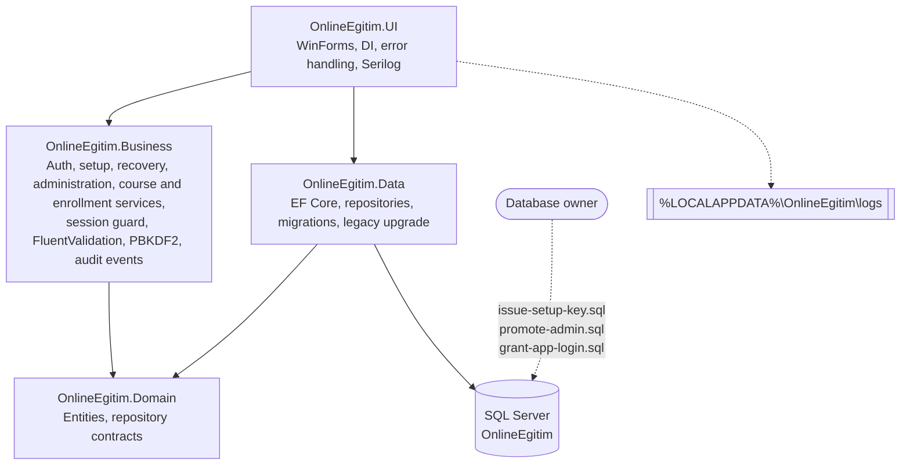

# 🎓 Online Eğitim - Online Learning Platform (C# & SQL Server)

🇬🇧 **English** · 🇹🇷 [Türkçe](README.tr.md)

A Windows Forms application built with .NET 10 and SQL Server with separate panels for students, teachers and
administrators: students register, search the courses, join and leave them and read their notes; teachers create,
edit and delete their courses with a capacity, add notes and see who joined; administrators manage the accounts. The code is split into Domain, Business, Data and UI layers; database access uses EF Core, and the
database is created and migrated automatically on startup.

> The application's user interface is in Turkish. Screen and button names below are given with their Turkish
> labels followed by an English translation, e.g. "Ders Seç" (Join Course).

---

## 📦 Features

### Student panel

- ✅ **Registration** ("Öğrenci Kayıt", Student Registration): name, e-mail address and a password of 8-64
  characters. A name or e-mail address that is taken ends like a new registration, so the screen does not tell
  whether someone has an account.
- ✅ **Sign-in** ("Öğrenci Girişi", Student Sign-in) with the name ("İsim Soyisim") and the password.
- ✅ **Course catalogue** ("Öğrenci Paneli", Student Panel): every course with its teacher and its seats, with a
  **search** by course name ("Kurs adı"), topic ("Konu") and teacher ("Öğretmen"), filters for free seats ("Yalnız
  boş yeri olanlar") and the student's own enrollment ("Kayıt"), and pages of 20 ("< Önceki" / "Sonraki >").
  Typed `%`, `_` and `[` are matched literally; the order (name, then id) is stable from page to page.
- ✅ **Joining a course** ("Ders Seç", Join Course) while it has a free seat; a course can be joined once.
- ✅ **Leaving a course** ("Dersten Ayrıl", Leave Course): the seat is freed at once and the course's notes are
  closed to the student. Joining the same course again is possible from the next day on, again only while a seat
  is free.
- ✅ **Course details** ("Kurs Detayları", Course Details): name, topic, teacher and the number of students; the
  notes only for courses the student joined. Students never see other students' names.
- ✅ **My courses** ("Kurslarım", My Courses) and their notes ("Kurs Notları", Course Notes).
- ✅ **Change my password** ("Şifremi Değiştir", Change My Password) with the current one; every open session of
  the account ends and the application returns to the sign-in.

### Teacher panel

- ✅ **Sign-in** ("Öğretmen / Yönetici Girişi", Teacher / Administrator Sign-in) with the name and the password.
- ✅ **New course** ("Yeni Kurs Ekle", Add Course): name, topic and **capacity** ("Kontenjan": 0-1000 seats, or
  "Sınırsız" for no limit; 0 closes the course to new students); the course always belongs to the signed-in
  teacher.
- ✅ **Edit a course** ("Kursu Düzenle", Edit Course): name, topic and capacity of the teacher's own course; the
  capacity cannot go below the number of students in the course.
- ✅ **Delete a course** ("Kursu Sil", Delete Course): asks for a confirmation that names the number of enrolled
  students and deletes only while the course still has that many. The course is kept as deleted (the
  application's login has no DELETE right) with its notes, its enrollments are closed, and it disappears from
  every list.
- ✅ **Notes** ("Not Ekle", Add Note): multi-line notes, only on the teacher's own courses.
- ✅ **Students of a course** ("Kayıtlı Öğrenciler", Enrolled Students), only for the teacher's own courses.
- ✅ **Recovery code** ("Kurtarma Kodu Üret", Issue Recovery Code) for a student of the teacher's own courses who
  has no password or forgot it.

### Administrator panel

- ✅ **First administrator** from the first-run setup ("İlk Kurulum"); a database whose teachers already sign in
  with passwords gets one from the database owner with `docs/promote-admin.sql`.
- ✅ **Accounts** ("Kullanıcı Yönetimi", User Management): search by name, e-mail address or specialty, filter by
  role, pages of 20. Passwords, hashes and codes are never shown.
- ✅ **New teacher or student** ("Yeni Hesap", New Account) without a password: a single use code (24 hours),
  shown once, with which the person sets their own password ("Kodla şifre belirle"). There is no default password.
- ✅ **Disable / enable** an account ("Devre Dışı Bırak" / "Etkinleştir"): a disabled account cannot sign in (same
  answer as a wrong password) and its open sessions end.
- ✅ **Make an administrator a teacher** ("Yöneticilikten Çıkar"); the last administrator who can sign in can be
  neither disabled nor demoted.
- ✅ **Reset code** ("Sıfırlama Kodu Üret", Issue Reset Code) for any account that forgot its password.

### Courses and notes

- ✅ Course names up to 100 characters, topics up to 200 and notes up to 500 (line breaks allowed), without control
  characters; central validators with Turkish messages.
- ✅ A missing and a foreign course get the same answer ("Ders bulunamadı.", Course not found), so ids cannot be
  probed.

### Security

- ✅ Passwords are stored as PBKDF2-HMAC-SHA256 hashes (600,000 iterations, random salt).
- ✅ 5 failed sign-ins lock the account for 15 minutes; unknown, locked, passwordless accounts and wrong passwords
  get the same answer and the same audit code.
- ✅ No default accounts: an empty database opens the first-run setup ("İlk Kurulum", First-run Setup); otherwise
  the founder needs a **setup key** that only the database owner can create (24 hours, single use).
- ✅ **Single use codes** for accounts without a password and for forgotten passwords (24 hours, single use,
  stored as a hash, shown once, never logged; wrong codes count towards the lockout).
- ✅ Every service call is checked against the signed-in session's role and ownership, and the session itself is
  checked against the database: a disabled, demoted or reset account's open session can do nothing more.
- ✅ Course seats are decided under one SQL Server application lock per course: two students never get the last
  seat, a capacity is never below the students, and a deletion never leaves a student in a deleted course.
- ✅ Daily log files without personal data, with anonymous audit codes; write buttons ignore repeated clicks while
  an operation is pending.

---

## 🖼️ Screenshots

The images below show the screens of the original application; the design work will replace them.

| | |
|---|---|
| <br>**Student sign-in** ("Öğrenci Girişi") | <br>**Student panel** ("Öğrenci Paneli") |
| <br>**Course details** ("Kurs Detayları") | <br>**My courses** ("Kurslarım") |
| <br>**Teacher sign-in** ("Öğretmen Giriş") | <br>**Teacher panel** ("Öğretmen Paneli") |

---

## 🔑 Permission Matrix

| Action | Student | Teacher | Administrator |
|---|---|---|---|
| Register an account | ✅ student accounts, from the sign-in screen | ❌ | ❌ (creates accounts in the panel) |
| Sign in | ✅ name + password | ✅ name + password | ✅ name + password (staff sign-in) |
| Search and list courses | ✅ with filters and pages | ❌ (sees their own courses) | ❌ |
| Join / leave a course | ✅ for themselves only, within the seats | ❌ | ❌ |
| See course details | ✅ every course; notes only of joined ones | ✅ their own courses only | ❌ |
| Create, edit, delete a course; set its capacity | ❌ | ✅ their own courses only | ❌ |
| Add a note | ❌ | ✅ to their own courses | ❌ |
| See who joined a course | ❌ (the count only) | ✅ their own courses | ❌ |
| Search and list accounts | ❌ | ❌ | ✅ (never passwords or codes) |
| Create teacher and student accounts | ❌ | ❌ | ✅ with a single use code, no password |
| Disable / enable an account | ❌ | ❌ | ✅ (not the last active administrator) |
| Make an administrator a teacher | ❌ | ❌ | ✅ (not the last active administrator) |
| Make an account an administrator | ❌ | ❌ | ❌ only the database owner (`docs/promote-admin.sql`) |
| Issue a single use code | ❌ | ✅ for students of their own courses | ✅ for any account |
| Set a password with a code | ✅ their own account | ✅ their own account | ✅ their own account |
| Set a first password with the setup key | ✅ only while enrolled in no course | ✅ while no teacher or administrator has a password | ✅ same |
| Change their own password | ✅ | ✅ | ✅ |
| See or change other accounts' data | ❌ | ❌ | only through the actions above |

---

## 🧰 Tech Stack

| Area | Used |
|---|---|
| Platform | .NET 10 (`net10.0-windows` UI, `net10.0` libraries) |
| UI | Windows Forms |
| Data access | Entity Framework Core 10 (SQL Server provider) |
| Database | Microsoft SQL Server (Express is enough) |
| Password hashing | PBKDF2-HMAC-SHA256 (`Rfc2898DeriveBytes.Pbkdf2`) |
| Validation | FluentValidation |
| Configuration / DI | Microsoft.Extensions.Configuration (JSON, user secrets, environment), Microsoft.Extensions.DependencyInjection |
| Logging | Serilog (file sink, daily rolling) |
| Testing | xUnit v3, Moq, EF Core SQLite (in-memory), optional real SQL Server tests |
| CI | GitHub Actions (`.github/workflows/ci.yml`) |

---

## 🗂️ Project Structure

```text
OnlineEgitimPlatformu/
├── src/
│   ├── OnlineEgitim.Domain/     # Entities (Student, Teacher, Course, CourseNote, Enrollment, SetupKey) and repository contracts
│   ├── OnlineEgitim.Business/   # Auth, setup, recovery, administration, course and enrollment services, session guard, Security/ (PBKDF2, lockout, setup keys), Validation/ (FluentValidation), Auditing/
│   ├── OnlineEgitim.Data/       # EF Core DbContext, configurations, Migrations/, legacy upgrade, demo data, repositories
│   └── OnlineEgitim.UI/         # WinForms screens, Infrastructure/ (errors, logging, dialogs, write guard), Program.cs (composition root)
├── tests/
│   ├── OnlineEgitim.Business.Tests/  # Validators, hashing, lockout, roles, ownership, setup and recovery (Moq)
│   ├── OnlineEgitim.Data.Tests/      # Services and repositories on SQLite; races, setup keys and legacy upgrade on SQL Server
│   └── OnlineEgitim.UI.Tests/        # Configuration, errors, logs, dialogs, focus and write guards (no windows shown)
├── assets/                      # Original logo, background and icon with their SVG sources
├── docs/
│   ├── THREAT_MODEL.md          # Threat model
│   ├── issue-setup-key.sql      # Setup key, run by the database owner
│   ├── promote-admin.sql        # Makes a teacher an administrator, run by the database owner
│   └── grant-app-login.sql      # Rights of the application's own login
├── screenshots/                 # Screens of the original application
├── .github/workflows/ci.yml     # Build, test and release workflow
├── CHANGELOG.md
└── onlineegitimplatformu.sln
```



The UI references Data only to register dependencies at startup; forms work through the Business services, which
take the signed-in session on every call. All database access is asynchronous and parameterised. The provider is
configured through DI (`AddDataAccess`), so tests can use SQLite in-memory.

---

## 🛠️ Setup and Usage

### Requirements

- .NET 10 SDK (Windows)
- SQL Server (for example SQL Server Express)

### 1. Configuration

Provide a connection string named `OnlineEgitim`. Any of the following works (later ones override earlier ones):

1. **`appsettings.json`**: copy `src/OnlineEgitim.UI/appsettings.example.json` to `appsettings.json` in the same
   folder and edit `ConnectionStrings:OnlineEgitim` (the server name for your environment). `appsettings.json` is
   git-ignored.

   ```json
   {
     "ConnectionStrings": {
       "OnlineEgitim": "Server=localhost\\SQLEXPRESS;Database=OnlineEgitim;Trusted_Connection=True;TrustServerCertificate=True;"
     },
     "Seed": {
       "Demo": false
     }
   }
   ```

2. **User secrets**:

   ```powershell
   dotnet user-secrets set "ConnectionStrings:OnlineEgitim" "<connection string>" --project src/OnlineEgitim.UI
   ```

3. **Environment variable** `ConnectionStrings__OnlineEgitim`.
4. **Environment variable** `EGITIM_CONNECTION` (highest priority).

> Inside JSON the `\` in `localhost\SQLEXPRESS` is written as `\\`. `TrustServerCertificate=True` is meant for a
> local development server only.

If no connection string is found, the application shows a Turkish message explaining these options and exits.

### 2. Running and migrations

```powershell
dotnet build -c Release
dotnet run --project src/OnlineEgitim.UI
```

Or open `onlineegitimplatformu.sln` in Visual Studio. The database is created on the first start and pending EF Core
migrations are applied on every start, so no manual `dotnet ef database update` is needed. Run that first start, and
every later start after a schema update, with the database owner's connection (see step 4).

To work with the migrations:

```powershell
dotnet tool restore
dotnet ef migrations list --project src/OnlineEgitim.Data
dotnet ef migrations add <Name> --project src/OnlineEgitim.Data --output-dir Persistence/Migrations
```

The design-time factory reads `EGITIM_CONNECTION` and otherwise uses a local SQL Server Express instance.

### 3. First run, the first administrator and the setup key

- There is no default account. If the database is **completely empty**, the application opens the first-run setup
  ("İlk Kurulum") and the **first administrator** is created without a key. The administrator then creates the
  teacher and student accounts in the administrator panel.
- A setup key is accepted only while **no teacher or administrator can sign in with a password**: for the first
  administrator of a database that has accounts but no administrator (the sign-in link "İlk yönetici kurulumu
  (kurulum anahtarı)", First Administrator Setup (setup key)), for the first password of a teacher or administrator
  without one ("Kodla şifre belirle" → "Öğretmen / Yönetici", Set Password With a Code → Teacher / Administrator),
  and **only** for a passwordless student who is enrolled in no course (the same screen, the key instead of a code).
  For a student enrolled in a course the key is refused and stays unused; that course's teacher issues a recovery
  code. Once a teacher or administrator has a password, no key is accepted.
- **A database whose teachers already sign in with passwords** (for example an upgraded database of the original
  application) therefore gets its first administrator from the database owner, who makes an existing teacher an
  administrator with their own rights:

  ```powershell
  # set @TeacherName in the script first
  sqlcmd -S <server> -d <database> -E -i docs\promote-admin.sql
  ```

  The script refuses to run for anyone but the database owner, and the database trigger `TR_Egitmenler_Rol`
  refuses any change that raises an account to administrator unless the owner makes it. For anyone else, also the
  application's login with direct SQL, it refuses a new administrator while another administrator exists or another
  teacher or administrator has a password; the only administrator such a login can add is the first one of the
  setup, in the same case where the application allows it. The promoted teacher's sessions end; an administrator does not teach, so that
  teacher's courses stay in the catalogue but can be edited again only after the account is a teacher again.
- Only the **database owner** (db_owner or DBA) creates keys:

  ```powershell
  sqlcmd -S <server> -d <database> -E -i docs\issue-setup-key.sql
  ```

  The script shows a 128 bit key from `CRYPT_GEN_RANDOM` once (32 hexadecimal characters) and stores only its
  SHA-256 hash; the key works for **24 hours**, **once**. `@RevokeUnusedKeys = 1` revokes earlier unused keys. The
  application cannot create keys.
- The key is used up in the same database transaction as the account write: a failed write does not spend it, and
  a used key cannot be used again from another Windows profile or computer. The expiry is checked again against the
  database clock when the key is used up, so a key that expires while the request waits for a lock is refused.
- A wrong, expired or used key never locks or revokes the founder's key; such a refusal returns after a short fixed
  pause. Refusals that do not check a key (a teacher with a password exists, a field is missing) return at once. The
  key is never logged or stored in plain text.
- `EGITIM_SETUP_KEY` only fills in the key field; the value is checked against the database like a typed key and
  grants nothing by itself. If it is not a key (32 hexadecimal characters once dashes and spaces are removed), the
  form shows a configuration warning.

### 4. The application's own login

Run the first start (migrations) with the database owner's connection, then switch the application to a separate
login. `docs/grant-app-login.sql` gives that login read and write rights on the account and course tables and, on
`KurulumAnahtarlari`, only `SELECT` and `UPDATE` of `Tuketildi`/`TuketimTarihi`; inserting, deleting or changing the
hash or expiry of a key is denied.

- The script only grants rights; it does **not** remove role memberships. The application's login must not be
  `db_owner` or `sysadmin` and must not own the database: such a login could write its own setup key.
- Pending migrations need more than these rights. Apply every schema update with the owner's connection first, then
  return to the restricted login.

### 5. Passwords: no password yet, forgotten or changed

Accounts without a password (left so by the original application, or created by an administrator) cannot sign in
with an empty or any other password. A password is set with a **single use code** while the account keeps its id
and its enrollments; the same code sets a new password for someone who **forgot** theirs:

- **Who issues a code:** an administrator for any account ("Sıfırlama Kodu Üret", or the code shown when creating
  the account); a teacher ("Kurtarma Kodu Üret") only for a student enrolled in one of that teacher's own courses.
  For another teacher's student, a student without a course or an unknown name the teacher gets the answer of a
  missing student, at the same cost, and nothing changes.
- **The code:** 10 characters, valid for 24 hours, stored only as a PBKDF2 hash, shown once and never logged. The
  old password keeps working until the code is used.
- **Using it:** "Kodla şifre belirle" (Set Password With a Code) on the sign-in screen, as a student or as a teacher /
  administrator: name, code and the new password twice. Wrong codes count towards the sign-in lockout; a used,
  replaced or expired code, an unknown name, a locked or a disabled account all get the same message. Every earlier
  session of the account ends.
- **Changing one's own password:** "Şifremi Değiştir" in every panel, with the current password; a wrong current
  password counts towards the lockout. On success every session of the account ends and the application returns
  to the sign-in.
- **Student enrolled in no course:** while no teacher or administrator can sign in with a password, the setup key in
  the code field; **teacher or administrator without a password:** the setup key under the same condition.

### 6. Upgrading the original database

A database created by the original application is upgraded in place on the first start, keeping its rows and ids.
Records whose identity is unclear (missing, padded or duplicate names or e-mail addresses, an enrollment key other
than `OgrenciID` and `DersID`, duplicate enrollments) stop the upgrade before any change; the error window and the log
show only the problem kind and its count. Fix the records and start the application again. Plain text passwords of
the original application are replaced with a hash on each account's next successful sign-in. Take a backup before the
first start with this version and keep it protected: it contains those plain text passwords.

### 7. Demo mode

Demo mode is off unless it is switched on explicitly, with the environment variable `EGITIM_DEMO=1` or the setting
`"Seed": { "Demo": true }`. Only then, and only when the database has no account or course yet, are fictional
accounts and courses added on start:

| Role | Sign-in name (demo mode only) | Password (demo mode only) |
|---|---|---|
| Teacher | `Deniz Örnek` (Yazılım), `Ece Taslak` (Tasarım) | `Demo.Ogretmen1`, `Demo.Ogretmen2` |
| Student | `Mert Deneme`, `Selin Deneme` | `Demo.Ogrenci1`, `Demo.Ogrenci2` |

Demo mode adds **no administrator**. Its teachers sign in with passwords, so no setup key is accepted either: to open
the administrator panel on a demo database, the database owner makes one of the demo teachers an administrator with
`docs/promote-admin.sql` (see [section 3](#3-first-run-the-first-administrator-and-the-setup-key)).

Never switch demo mode on for a database with real data.

### 8. Logs

Logs are written to `%LOCALAPPDATA%\OnlineEgitim\logs\onlineegitim-YYYYMMDD.log`, one file per day. Files dated more
than 30 days ago are deleted, and at most 30 files are kept. Error entries contain only exception types, HResult codes
and the method names of the stack trace (no file paths); refused operations log only the exception type. Audit
entries are a fixed code and a role, for example:

```text
2026-11-19 10:42:07.118 +03:00 [INF] Audit auth.sign_in.failed student
2026-11-19 10:42:31.502 +03:00 [INF] Audit auth.sign_in.succeeded student
2026-11-19 10:58:12.034 +03:00 [INF] Audit course.note.added teacher
```

Names, e-mail addresses, passwords, recovery codes, setup keys, note contents and exception messages are never
written to the log.

---

## 🔐 Security

See [docs/THREAT_MODEL.md](docs/THREAT_MODEL.md) for the threat model.

- Passwords are hashed with PBKDF2; the stored format is kept in its own column, so a value is never read in another
  format. Plain text passwords of the original application are upgraded on the next successful sign-in.
- Lockout counters are updated atomically, and a successful sign-in is written only while the account is still
  unlocked, so concurrent attempts cannot clear a fresh lock.
- Roles and ownership are checked in the services and repeated in the database writes; a missing and a foreign
  course get the same answer.
- Every service call checks the session against the database (role, disabled flag, session version), so a demoted,
  disabled or reset account's open session can do nothing more and gets one "session ended" message.
- Setup keys and promotions to administrator come only from the database owner; single use codes only from an
  administrator or the student's own teacher.
- Seats are counted under one `sp_getapplock` lock per course, and changes that can lower the number of active
  administrators under one administrators' lock.
- Connection strings are kept out of the repository (`appsettings.json` is ignored; user secrets and environment
  variables are supported). All queries go through EF Core with parameters.
- Users only see Turkish messages; raw exception text is never shown.

---

## 🧪 Testing

### Manual testing

1. On an empty database, create the first administrator in "İlk Kurulum"; a second setup is refused.
2. As the administrator, create a teacher; note the code, set the teacher's password with "Kodla şifre belirle" and
   sign in as the teacher. Using the code again is refused.
3. Register a student with an invalid e-mail address or a 7 character password; then register correctly and sign in.
4. Enter a wrong password five times: the sixth attempt is refused with the same message even with the right
   password, and works again after 15 minutes.
5. As the teacher, create a course with a capacity of 1 and add a note; as the student, join it and read the note; a
   second student is told the course is full. Leave the course as the first student: the note is hidden, the second
   student can join, and the first one cannot join again the same day.
6. As the teacher, try to lower the capacity below the students (refused), then delete the course: the confirmation
   names the number of students and the course disappears for everyone.
7. As the administrator, disable the student while the student is signed in: the student's next action ends the
   session and the sign-in is refused. Try to disable the only administrator: refused.
8. Change a password with "Şifremi Değiştir": the panel returns to the sign-in and the old password no longer works.
9. Stop SQL Server and check that a friendly Turkish error is shown and the log file contains only types and
   method names.

### Automated tests

```powershell
dotnet test -c Release
```

| Project | Type | Scope | Result (`-c Release`) |
|---|---|---|---|
| `tests/OnlineEgitim.Business.Tests` | Unit | Validator limits and message order, PBKDF2 and format upgrade, lockout, uniform refusals and audit codes, roles and ownership of courses, notes and enrollments, capacity, leaving and search, administration, session guard, password change and reset codes, setup keys and recovery with strict Moq mocks | 259 passed |
| `tests/OnlineEgitim.Data.Tests` | Integration | Services and repositories on SQLite in-memory (lockout, hash upgrade, ownership, recovery, refused input, capacity and deletion, leaving and search, administration, password resets); on SQL Server: enrollment, last seat, capacity, deletion, administrator, code and sign-in races, a key expiring while waiting, the application login's rights, owner-only promotion, the legacy upgrade and its lock | 105 passed with SQL Server and `EGITIM_LEGACY_BACKUP` (104 and 1 skipped without the backup); 75 passed, 30 skipped without SQL Server |
| `tests/OnlineEgitim.UI.Tests` | Unit | Example configuration, error messages, log content, retention and files, dialog helper, focus after unlock, write guards, latest-wins loading and search, course, account and password windows, ended sessions, neutral branding | 75 passed |

The SQL Server tests use throw-away databases on the server in `EGITIM_TEST_SQLSERVER` (default: local SQL Express
with Windows authentication) and are skipped when `EGITIM_SKIP_SQL_TESTS=1` is set or no server is reachable. The
temporary databases are dropped afterwards. The test with a restored backup of the original database runs only when
`EGITIM_LEGACY_BACKUP` points to a `.bak` file that the SQL Server service can read.

```powershell
$env:EGITIM_SKIP_SQL_TESTS = "1"; dotnet test -c Release
```

On SQLite the schema is created from the model instead of migrations. The UI tests create forms without showing them,
replace every message box and run serially, so no window opens.

---

## 🚀 CI and Release

`.github/workflows/ci.yml` runs on pushes to `main`, on pull requests and on `v*` tags (Windows, .NET 10):

1. **Build:** `dotnet build -c Release`
2. **Test:** `dotnet test -c Release` (SQL Server tests skipped)
3. **Release (only on `v*` tags):** the tag name is passed through an environment variable and checked against
   `^v[A-Za-z0-9._-]+$`; a framework-dependent win-x64 build is then published and uploaded as the workflow artifact
   `OnlineEgitim-<tag>-win-x64.zip`, with the READMEs, changelogs, the threat model and the two SQL scripts.

To produce the same build locally:

```powershell
dotnet publish src/OnlineEgitim.UI -c Release -r win-x64 --self-contained false -o ./publish
```

The target machine needs the .NET 10 Desktop Runtime. Put `appsettings.json` next to `OnlineEgitim.exe` or set
`EGITIM_CONNECTION`.

---

## 👨‍💻 Developer Notes

- See [CHANGELOG.md](CHANGELOG.md) for the version history.
- `Program.cs` is the composition root: configuration, DI, logging, the audit sink and the global
  `ThreadException` / `UnhandledException` handlers are set up there.
- Business rule violations raise `BusinessRuleException` and permission violations `AccessDeniedException`, both with
  fixed Turkish messages that the UI shows as warnings.
- Validators live in `OnlineEgitim.Business/Validation` and stop at the first failure, so the user sees one message at
  a time.
- New write buttons should go through `ExclusiveOperation` and move the focus with `FocusAfterUnlock`; loads
  triggered by a selection should use `RequestSequence` so only the latest response is shown, and filling a list from
  code must not count as a user selection. Message boxes go through `Dialogs` or `IUserPrompts`, never `MessageBox`
  directly.
- Audit events (`IAuditLog`) carry only an event kind and a role; do not add identifying data to them.

---

**Note:** This is an educational project and is open to further development.
