# 🎓 Online Eğitim - Online Eğitim Platformu (C# & SQL Server)

🇬🇧 [English](README.md) · 🇹🇷 **Türkçe**

.NET 10 ve SQL Server ile geliştirilmiş, öğrenci, öğretmen ve yönetici için ayrı panelleri olan bir Windows Forms
uygulaması: öğrenciler kayıt olur, kursları arar, kurslara katılır ve ayrılır, notlarını okur; öğretmenler kontenjanlı
kurslarını oluşturur, düzenler ve siler, not ekler ve kimlerin katıldığını görür; yöneticiler hesapları yönetir. Kod Domain, Business, Data ve UI katmanlarına ayrılmıştır; veritabanı erişimi EF Core ile
yapılır, veritabanı açılışta otomatik oluşturulur ve güncellenir.

> Uygulamanın arayüzü Türkçedir. Aşağıda ekran ve düğme adları Türkçe etiketleriyle, ardından İngilizce
> karşılıklarıyla verilmiştir, örneğin "Ders Seç" (Join Course).

---

## 📦 Özellikler

### Öğrenci paneli

- ✅ **Kayıt** ("Öğrenci Kayıt", Student Registration): ad, e-posta adresi ve 8-64 karakterlik şifre. Kullanılan bir
  ad veya e-posta adresi yeni bir kayıt gibi sonuçlanır; ekran birinin hesabı olup olmadığını söylemez.
- ✅ **Giriş** ("Öğrenci Girişi", Student Sign-in): ad ("İsim Soyisim") ve şifreyle.
- ✅ **Kurs listesi** ("Öğrenci Paneli", Student Panel): tüm kurslar, öğretmenleri ve kontenjanlarıyla; kurs adı
  ("Kurs adı"), konu ("Konu") ve öğretmene ("Öğretmen") göre **arama**, boş kontenjan ("Yalnız boş yeri olanlar") ve
  kayıt durumu ("Kayıt") filtreleri, 20'şerlik sayfalar ("< Önceki" / "Sonraki >"). Yazılan `%`, `_` ve `[` olduğu
  gibi aranır; sıralama (ad, sonra kimlik) sayfadan sayfaya kararlıdır.
- ✅ **Kursa katılma** ("Ders Seç", Join Course), boş yer varken; bir kursa bir kez katılınır.
- ✅ **Kurstan ayrılma** ("Dersten Ayrıl", Leave Course): yer hemen boşalır ve kursun notları öğrenciye kapanır. Aynı
  kursa yeniden kayıt ertesi günden itibaren, yine yalnızca boş yer varken mümkündür.
- ✅ **Kurs detayları** ("Kurs Detayları", Course Details): ad, konu, öğretmen ve öğrenci sayısı; notlar yalnızca
  öğrencinin katıldığı kurslarda. Öğrenciler diğer öğrencilerin adlarını hiçbir zaman görmez.
- ✅ **Kurslarım** ("Kurslarım", My Courses) ve notları ("Kurs Notları", Course Notes).
- ✅ **Şifremi değiştir** ("Şifremi Değiştir", Change My Password), mevcut şifreyle; hesabın tüm açık oturumları
  kapanır ve uygulama girişe döner.

### Öğretmen paneli

- ✅ **Giriş** ("Öğretmen / Yönetici Girişi", Teacher / Administrator Sign-in): ad ve şifreyle.
- ✅ **Yeni kurs** ("Yeni Kurs Ekle", Add Course): ad, konu ve **kontenjan** ("Kontenjan": 0-1000 kişi ya da
  sınırsız için "Sınırsız"; 0 kursu yeni öğrencilere kapatır); kurs her zaman giriş yapan öğretmene aittir.
- ✅ **Kursu düzenleme** ("Kursu Düzenle", Edit Course): kendi kursunun adı, konusu ve kontenjanı; kontenjan kurstaki
  öğrenci sayısının altına indirilemez.
- ✅ **Kursu silme** ("Kursu Sil", Delete Course): kayıtlı öğrenci sayısını söyleyen bir onay ister ve kursta hâlâ o
  kadar öğrenci varsa siler. Kurs silinmiş olarak işaretlenip notlarıyla saklanır (uygulama login'inin DELETE hakkı
  yoktur), kayıtları kapanır ve tüm listelerden kalkar.
- ✅ **Notlar** ("Not Ekle", Add Note): çok satırlı notlar, yalnızca öğretmenin kendi kurslarına.
- ✅ **Kursun öğrencileri** ("Kayıtlı Öğrenciler", Enrolled Students), yalnızca öğretmenin kendi kurslarında.
- ✅ **Kurtarma kodu** ("Kurtarma Kodu Üret", Issue Recovery Code): öğretmenin kendi kurslarındaki, şifresi olmayan
  veya şifresini unutan bir öğrenci için.

### Yönetici paneli

- ✅ **İlk yönetici** ilk kurulumdan ("İlk Kurulum") gelir; öğretmenleri zaten şifreyle giriş yapan bir veritabanı
  yöneticisini veritabanı sahibinden `docs/promote-admin.sql` ile alır.
- ✅ **Hesaplar** ("Kullanıcı Yönetimi", User Management): ada, e-posta adresine veya uzmanlığa göre arama, role göre
  filtre, 20'şerlik sayfalar. Şifreler, özetler ve kodlar hiçbir zaman gösterilmez.
- ✅ **Yeni öğretmen veya öğrenci** ("Yeni Hesap", New Account) şifresiz açılır: tek kullanımlık, 24 saat geçerli,
  yalnızca bir kez gösterilen bir kod; kişi kendi şifresini bununla belirler ("Kodla şifre belirle"). Varsayılan şifre
  yoktur.
- ✅ **Devre dışı bırakma / etkinleştirme** ("Devre Dışı Bırak" / "Etkinleştir"): devre dışı hesap giriş yapamaz (yanlış
  şifreyle aynı yanıt) ve açık oturumları kapanır.
- ✅ **Yöneticiyi öğretmen yapma** ("Yöneticilikten Çıkar"); giriş yapabilen son yönetici ne devre dışı bırakılabilir
  ne de yöneticilikten çıkarılabilir.
- ✅ **Sıfırlama kodu** ("Sıfırlama Kodu Üret", Issue Reset Code): şifresini unutan her hesap için.

### Kurslar ve notlar

- ✅ Kurs adı en fazla 100, konu en fazla 200, not en fazla 500 karakter (notta satır sonu serbest), denetim
  karakteri yok; Türkçe mesajlı merkezi doğrulayıcılar.
- ✅ Olmayan bir kurs ile başkasının kursu aynı yanıtı alır ("Ders bulunamadı.", Course not found); kimlik numaraları
  yoklanamaz.

### Güvenlik

- ✅ Şifreler PBKDF2-HMAC-SHA256 özeti olarak saklanır (600.000 tekrar, rastgele tuz).
- ✅ 5 hatalı giriş hesabı 15 dakika kilitler; bilinmeyen, kilitli, şifresiz hesaplar ve yanlış şifre aynı yanıtı
  ve aynı denetim kodunu alır.
- ✅ Hazır hesap yoktur: boş veritabanı ilk kurulumu ("İlk Kurulum", First-run Setup) açar; aksi halde kurucu,
  yalnızca veritabanı sahibinin üretebildiği bir **kurulum anahtarına** ihtiyaç duyar (24 saat, tek kullanım).
- ✅ Şifresiz hesaplar ve unutulan şifreler için **tek kullanımlık kodlar** (24 saat, tek kullanım, özet olarak
  saklanır, bir kez gösterilir, günlüğe yazılmaz; hatalı kodlar giriş kilidine sayılır).
- ✅ Her servis çağrısı giriş yapan oturumun rolüne ve sahipliğine göre, oturumun kendisi de veritabanına göre
  denetlenir: devre dışı bırakılan, yöneticilikten çıkarılan veya şifresi sıfırlanan hesabın açık oturumu artık hiçbir
  şey yapamaz.
- ✅ Kurs kontenjanı kurs başına bir SQL Server uygulama kilidi altında belirlenir: son yeri iki öğrenci alamaz,
  kontenjan öğrenci sayısının altına inemez, silme bir öğrenciyi silinmiş kursta bırakmaz.
- ✅ Kişisel veri içermeyen, anonim denetim kodlu günlük dosyaları; yazma düğmeleri işlem sürerken tekrarlanan
  tıklamaları yok sayar.

---

## 🖼️ Ekran Görüntüleri

Ekranlar uydurma bir okulla (uydurma kişiler, example.com adresleri, kurslar ve açıkça örnek bir kod) pencere
açılmadan çizilir; gerçek veri içermez. Her görsel 2x sürümüne bağlanır. Yeniden çizmek için:
`dotnet run --project tools/Screenshots -c Release -- screenshots`.

| | |
|---|---|
| [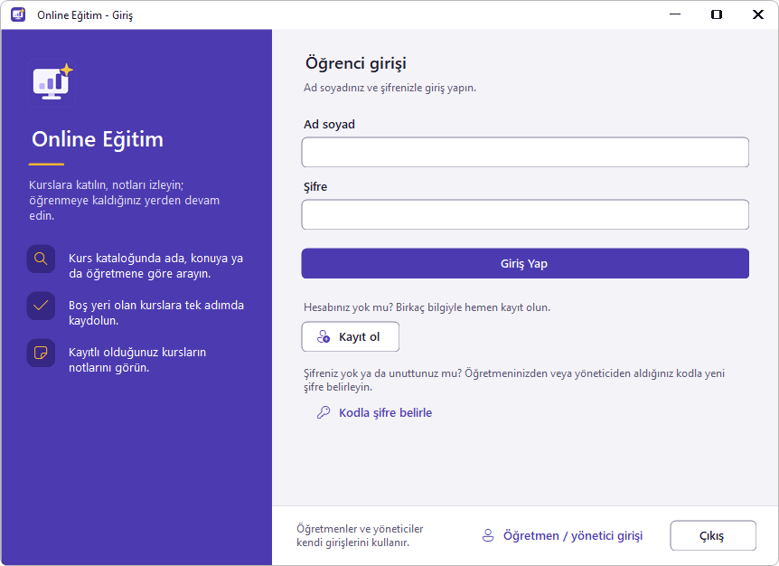](screenshots/ogrenci-girisi-2x.png)<br>**Öğrenci girişi** | [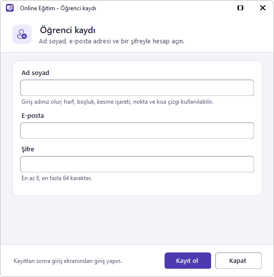](screenshots/ogrenci-kaydi-2x.png)<br>**Öğrenci kaydı** |
| [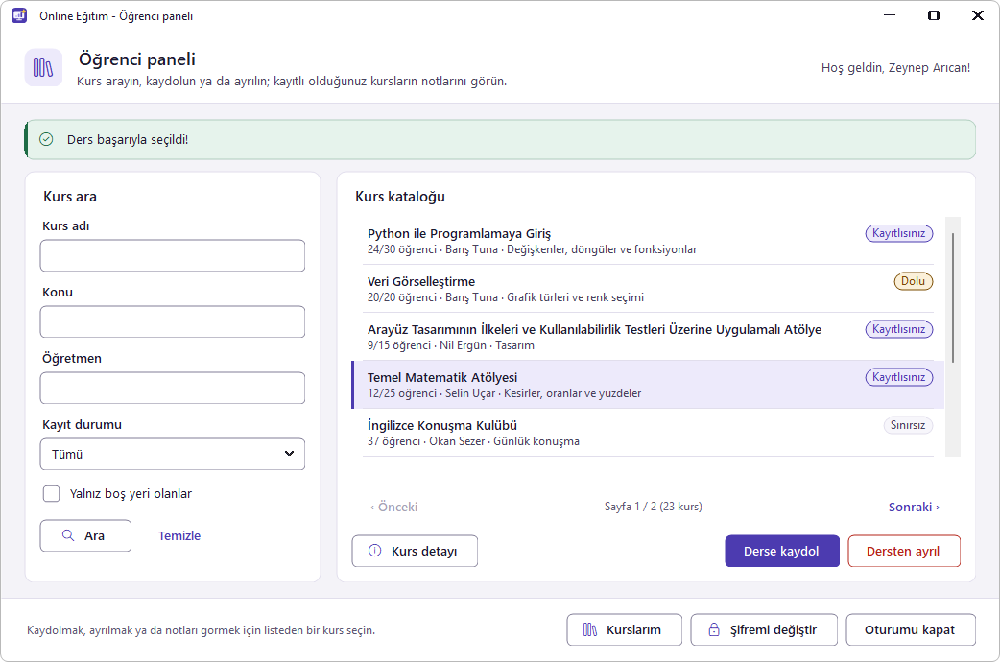](screenshots/ogrenci-paneli-2x.png)<br>**Öğrenci paneli**: arama, kontenjan ve durumuyla katalog, bir kursa kaydolduktan sonra | [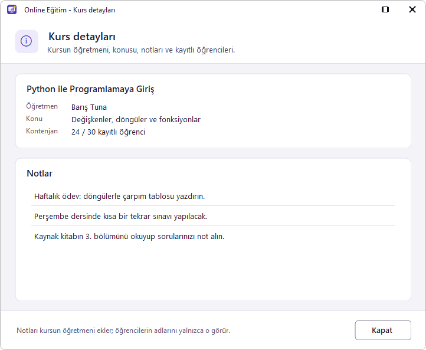](screenshots/kurs-detayi-2x.png)<br>**Kurs detayları** ve notlar |
| [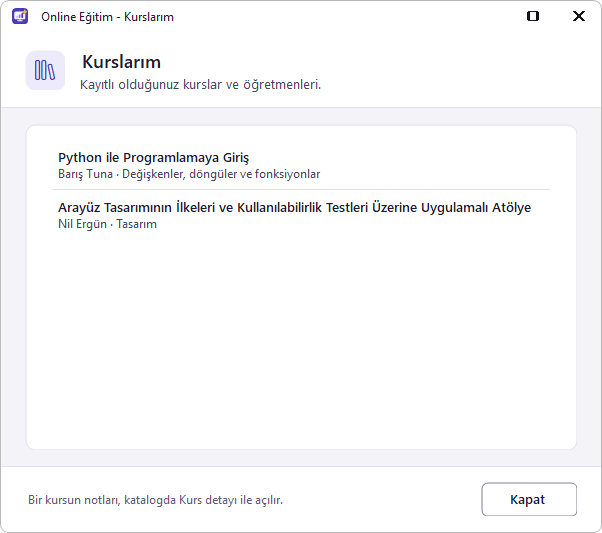](screenshots/kurslarim-2x.png)<br>**Kurslarım** | [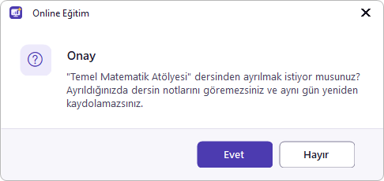](screenshots/onay-penceresi-2x.png)<br>Dersten ayrılmadan önce **onay** |
| [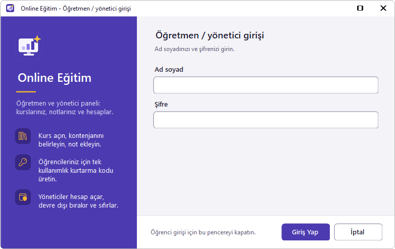](screenshots/ogretmen-girisi-2x.png)<br>**Öğretmen / yönetici girişi** | [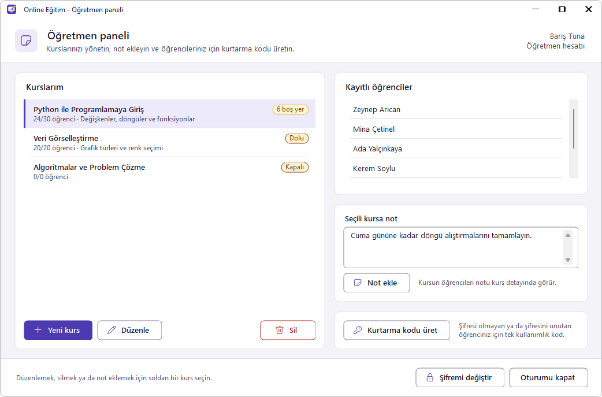](screenshots/ogretmen-paneli-2x.png)<br>**Öğretmen paneli**: kurslar, öğrenciler, notlar |
| [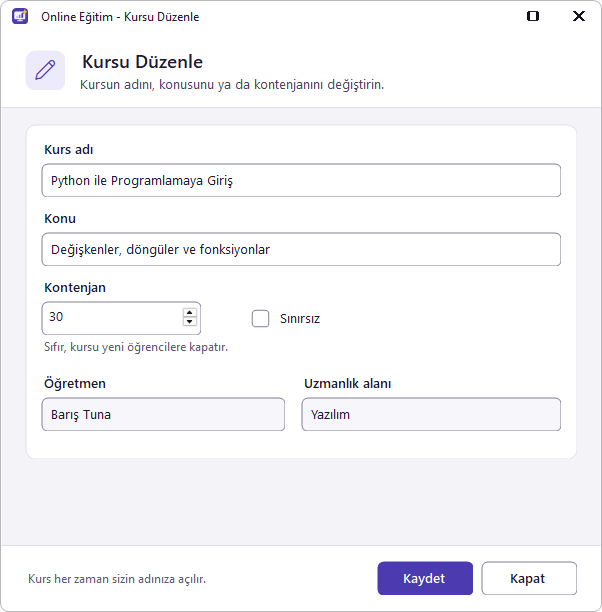](screenshots/kurs-duzenleme-2x.png)<br>**Kursu düzenle**, kontenjanla | [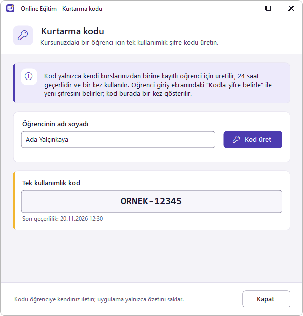](screenshots/kurtarma-kodu-2x.png)<br>Öğrenci için **kurtarma kodu**, bir kez gösterilir |
| [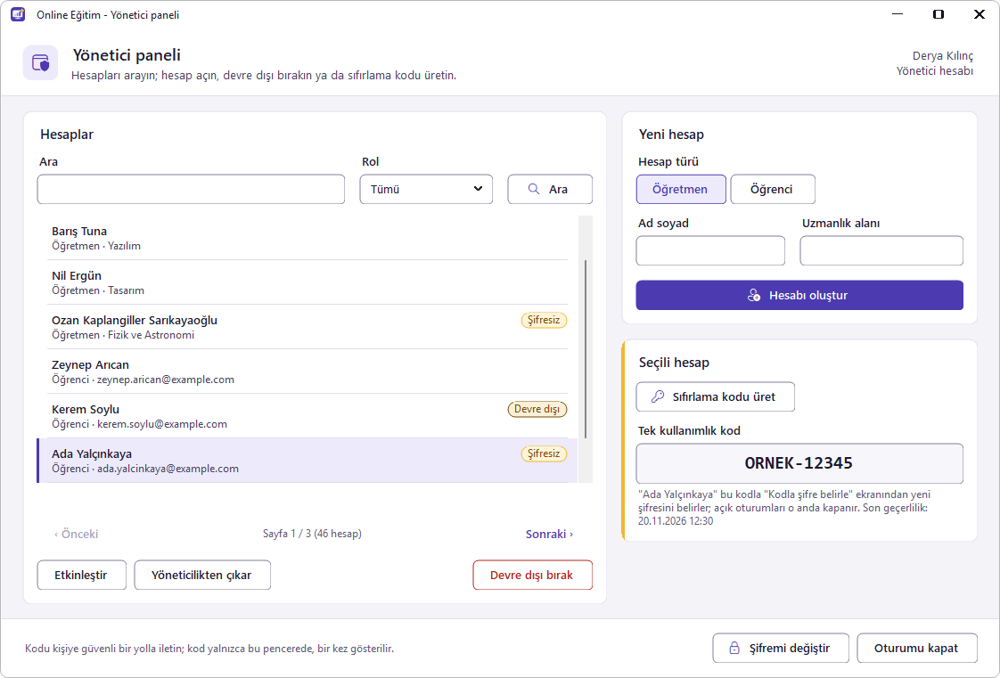](screenshots/yonetici-paneli-2x.png)<br>Sıfırlama kodundan sonra **yönetici paneli** | [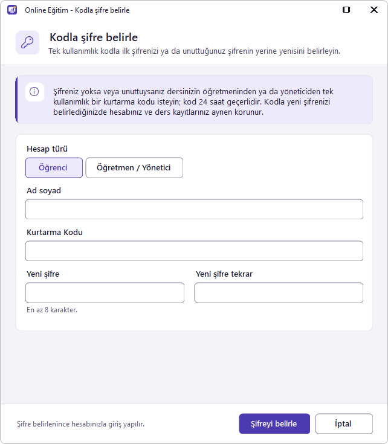](screenshots/hesap-kurtarma-2x.png)<br>**Kodla şifre belirle** |
| [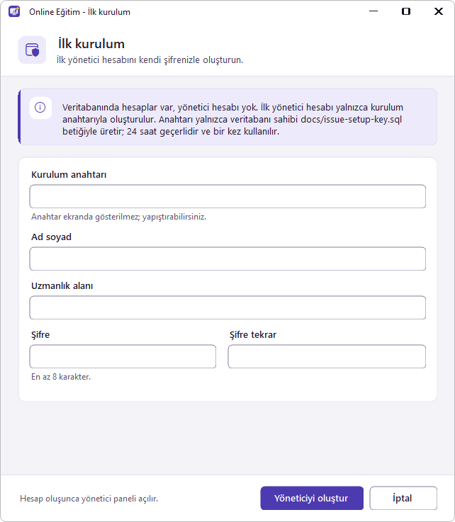](screenshots/ilk-kurulum-2x.png)<br>Kurulum anahtarıyla **ilk kurulum** | [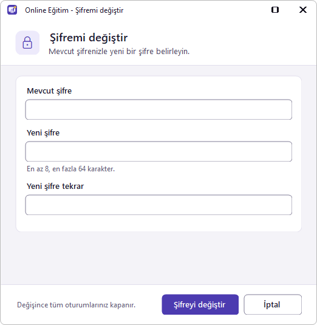](screenshots/sifre-degistirme-2x.png)<br>**Şifremi değiştir** |

---

## 🔑 Yetki Matrisi

| İşlem | Öğrenci | Öğretmen | Yönetici |
|---|---|---|---|
| Hesap oluşturma | ✅ öğrenci hesabı, giriş ekranından | ❌ | ❌ (panelde hesap açar) |
| Giriş | ✅ ad + şifre | ✅ ad + şifre | ✅ ad + şifre (personel girişi) |
| Kursları arama ve listeleme | ✅ filtre ve sayfalarla | ❌ (kendi kurslarını görür) | ❌ |
| Kursa katılma / ayrılma | ✅ yalnızca kendisi için, kontenjan içinde | ❌ | ❌ |
| Kurs detaylarını görme | ✅ tüm kurslar; notlar yalnızca katıldıklarında | ✅ yalnızca kendi kursları | ❌ |
| Kurs oluşturma, düzenleme, silme; kontenjan | ❌ | ✅ yalnızca kendi kursları | ❌ |
| Not ekleme | ❌ | ✅ kendi kurslarına | ❌ |
| Kursa kimlerin katıldığını görme | ❌ (yalnızca sayı) | ✅ kendi kurslarında | ❌ |
| Hesapları arama ve listeleme | ❌ | ❌ | ✅ (şifre ve kod hiçbir zaman) |
| Öğretmen ve öğrenci hesabı açma | ❌ | ❌ | ✅ tek kullanımlık kodla, şifresiz |
| Hesabı devre dışı bırakma / etkinleştirme | ❌ | ❌ | ✅ (son etkin yönetici hariç) |
| Yöneticiyi öğretmen yapma | ❌ | ❌ | ✅ (son etkin yönetici hariç) |
| Hesabı yönetici yapma | ❌ | ❌ | ❌ yalnızca veritabanı sahibi (`docs/promote-admin.sql`) |
| Tek kullanımlık kod üretme | ❌ | ✅ kendi kurslarındaki öğrenciler için | ✅ her hesap için |
| Kodla şifre belirleme | ✅ kendi hesabı | ✅ kendi hesabı | ✅ kendi hesabı |
| Kurulum anahtarıyla ilk şifre belirleme | ✅ yalnızca hiçbir derse kayıtlı değilken | ✅ şifreli öğretmen veya yönetici yokken | ✅ aynı |
| Kendi şifresini değiştirme | ✅ | ✅ | ✅ |
| Başka hesapların verisini görme veya değiştirme | ❌ | ❌ | yalnızca yukarıdaki işlemlerle |

---

## 🧰 Kullanılan Teknolojiler

| Alan | Kullanılan |
|---|---|
| Platform | .NET 10 (`net10.0-windows` arayüz, `net10.0` kütüphaneler) |
| Arayüz | Windows Forms |
| Veri erişimi | Entity Framework Core 10 (SQL Server sağlayıcısı) |
| Veritabanı | Microsoft SQL Server (Express yeterli) |
| Şifre özeti | PBKDF2-HMAC-SHA256 (`Rfc2898DeriveBytes.Pbkdf2`) |
| Doğrulama | FluentValidation |
| Yapılandırma / DI | Microsoft.Extensions.Configuration (JSON, user secrets, ortam), Microsoft.Extensions.DependencyInjection |
| Günlük | Serilog (dosya hedefi, günlük dönen) |
| Test | xUnit v3, Moq, EF Core SQLite (bellek içi), isteğe bağlı gerçek SQL Server testleri |
| CI | GitHub Actions (`.github/workflows/ci.yml`) |

---

## 🗂️ Proje Yapısı

```text
OnlineEgitimPlatformu/
├── src/
│   ├── OnlineEgitim.Domain/     # Varlıklar (Student, Teacher, Course, CourseNote, Enrollment, SetupKey) ve depo sözleşmeleri
│   ├── OnlineEgitim.Business/   # Giriş, kurulum, kurtarma, yönetim, kurs ve kayıt servisleri, oturum denetimi, Security/ (PBKDF2, kilit, kurulum anahtarı), Validation/ (FluentValidation), Auditing/
│   ├── OnlineEgitim.Data/       # EF Core DbContext, yapılandırmalar, Migrations/, eski veritabanı yükseltmesi, demo verisi, depolar
│   └── OnlineEgitim.UI/         # WinForms ekranları, Infrastructure/ (hatalar, günlük, iletişim kutuları, yazma koruması), Program.cs (bileşim kökü)
├── tests/
│   ├── OnlineEgitim.Business.Tests/  # Doğrulayıcılar, özet, kilit, rol, sahiplik, kurulum ve kurtarma (Moq)
│   ├── OnlineEgitim.Data.Tests/      # SQLite üzerinde servisler ve depolar; SQL Server'da yarışlar, kurulum anahtarı ve eski veritabanı yükseltmesi
│   └── OnlineEgitim.UI.Tests/        # Yapılandırma, hatalar, günlükler, iletişim kutuları, odak ve yazma korumaları (pencere açılmaz)
├── assets/                      # SVG kaynaklarıyla özgün logo, arka plan ve simge
├── docs/
│   ├── THREAT_MODEL.md          # Tehdit modeli (İngilizce)
│   ├── promote-admin.sql        # Öğretmeni yönetici yapar, veritabanı sahibi çalıştırır
│   ├── issue-setup-key.sql      # Kurulum anahtarı, veritabanı sahibi çalıştırır
│   └── grant-app-login.sql      # Uygulamanın kendi login'inin hakları
├── screenshots/                 # Özgün uygulamanın ekranları
├── .github/workflows/ci.yml     # Derleme, test ve sürüm iş akışı
├── CHANGELOG.md
└── onlineegitimplatformu.sln
```

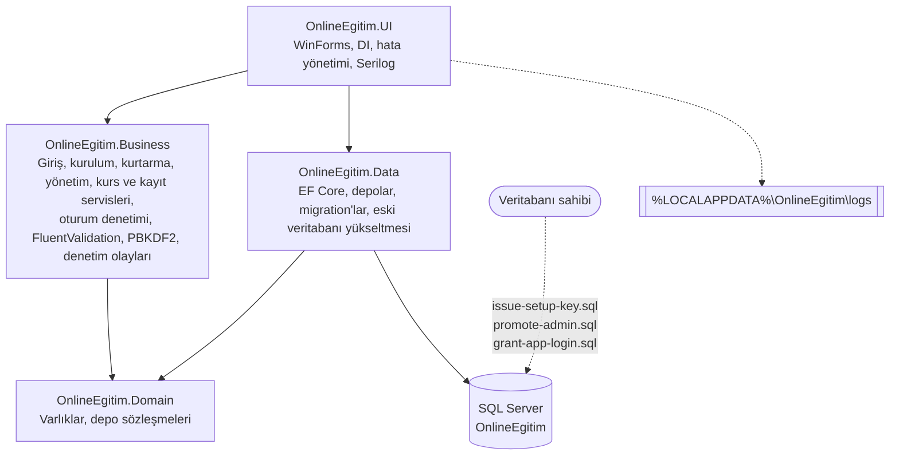

Arayüz Data katmanına yalnızca açılışta bağımlılıkları kaydetmek için başvurur; formlar her çağrıda giriş yapan
oturumu alan Business servisleri üzerinden çalışır. Tüm veritabanı erişimi asenkron ve parametrelidir. Sağlayıcı DI
(`AddDataAccess`) üzerinden yapılandırılır, böylece testler SQLite bellek içi veritabanı kullanabilir.

---

## 🛠️ Kurulum ve Kullanım

### Gereksinimler

- .NET 10 SDK (Windows)
- SQL Server (örneğin SQL Server Express)

### 1. Yapılandırma

`OnlineEgitim` adlı bir bağlantı cümlesi verin. Aşağıdakilerin hepsi çalışır (sonrakiler öncekileri geçersiz kılar):

1. **`appsettings.json`**: `src/OnlineEgitim.UI/appsettings.example.json` dosyasını aynı klasörde `appsettings.json`
   adıyla kopyalayın ve `ConnectionStrings:OnlineEgitim` değerini (sunucu adını kendi ortamınıza göre) düzenleyin.
   `appsettings.json` git'e eklenmez.

   ```json
   {
     "ConnectionStrings": {
       "OnlineEgitim": "Server=localhost\\SQLEXPRESS;Database=OnlineEgitim;Trusted_Connection=True;TrustServerCertificate=True;"
     },
     "Seed": {
       "Demo": false
     }
   }
   ```

2. **User secrets**:

   ```powershell
   dotnet user-secrets set "ConnectionStrings:OnlineEgitim" "<bağlantı cümlesi>" --project src/OnlineEgitim.UI
   ```

3. **Ortam değişkeni** `ConnectionStrings__OnlineEgitim`.
4. **Ortam değişkeni** `EGITIM_CONNECTION` (en yüksek öncelik).

> JSON içinde `localhost\SQLEXPRESS` içindeki `\`, `\\` olarak yazılır. `TrustServerCertificate=True` yalnızca yerel
> geliştirme sunucusu içindir.

Bağlantı cümlesi bulunamazsa uygulama bu seçenekleri açıklayan Türkçe bir mesaj gösterip kapanır.

### 2. Çalıştırma ve migration'lar

```powershell
dotnet build -c Release
dotnet run --project src/OnlineEgitim.UI
```

Ya da `onlineegitimplatformu.sln` dosyasını Visual Studio ile açın. Veritabanı ilk açılışta oluşturulur ve bekleyen EF
Core migration'ları her açılışta uygulanır; elle `dotnet ef database update` gerekmez. İlk açılışı ve her şema
güncellemesinden sonraki açılışı veritabanı sahibinin bağlantısıyla yapın (bkz. adım 4).

Migration'larla çalışmak için:

```powershell
dotnet tool restore
dotnet ef migrations list --project src/OnlineEgitim.Data
dotnet ef migrations add <Ad> --project src/OnlineEgitim.Data --output-dir Persistence/Migrations
```

Tasarım zamanı fabrikası `EGITIM_CONNECTION` değişkenini okur, yoksa yerel SQL Server Express örneğini kullanır.

### 3. İlk açılış, ilk yönetici ve kurulum anahtarı

- Hazır hesap yoktur. Veritabanı **tamamen boşsa** uygulama **İlk Kurulum** ekranıyla açılır ve **ilk yönetici**
  anahtarsız oluşturulur. Öğretmen ve öğrenci hesaplarını sonra yönetici panelinden yönetici açar.
- Kurulum anahtarı yalnızca **şifreyle giriş yapabilen hiçbir öğretmen veya yönetici yokken** kabul edilir:
  hesapları olan ama yöneticisi olmayan veritabanında ilk yönetici (girişteki **İlk yönetici kurulumu (kurulum
  anahtarı)** bağlantısı), şifresiz bir öğretmen veya yöneticiye ilk şifre (**Kodla şifre belirle** → **Öğretmen /
  Yönetici**) ve **yalnızca** hiçbir derse kayıtlı olmayan şifresiz bir öğrenciye ilk şifre (aynı ekranda kod yerine
  anahtar). Derse kayıtlı öğrenci için anahtar reddedilir ve kullanılmamış kalır; kurtarma kodunu o dersin öğretmeni
  üretir. Şifreli bir öğretmen veya yönetici varken anahtar kabul edilmez.
- **Öğretmenleri zaten şifreyle giriş yapan bir veritabanı** (örneğin yükseltilmiş özgün veritabanı) bu yüzden ilk
  yöneticisini veritabanı sahibinden alır; sahip, kendi yetkisiyle mevcut bir öğretmeni yönetici yapar:

  ```powershell
  # önce betikteki @TeacherName değerini girin
  sqlcmd -S <sunucu> -d <veritabanı> -E -i docs\promote-admin.sql
  ```

  Betik veritabanı sahibinden başkası için çalışmaz; `TR_Egitmenler_Rol` tetikleyicisi de bir hesabı yöneticiliğe
  yükselten her değişikliği, sahip yapmadıkça reddeder. Sahip dışında herkes için, doğrudan SQL kullanan uygulama
  login'i dahil, başka bir yönetici varken ya da şifreli başka bir öğretmen veya yönetici varken yeni yönetici
  eklemeyi de reddeder; böyle bir login'in ekleyebileceği tek yönetici, uygulamanın da izin verdiği durumda kurulumun
  ilk yöneticisidir. Yükseltilen öğretmenin
  oturumları kapanır; yönetici ders vermez, o öğretmenin kursları katalogda kalır ama hesap yeniden öğretmen olana
  kadar düzenlenemez.
- Anahtarı **yalnızca veritabanı sahibi** (db_owner veya DBA) üretir:

  ```powershell
  sqlcmd -S <sunucu> -d <veritabanı> -E -i docs\issue-setup-key.sql
  ```

  Betik `CRYPT_GEN_RANDOM` ile 128 bitlik anahtarı bir kez gösterir (32 onaltılık karakter), veritabanına yalnızca
  SHA-256 özetini yazar; anahtar **24 saat** geçerlidir ve **bir kez** kullanılır. `@RevokeUnusedKeys = 1` önceki
  kullanılmamış anahtarları iptal eder. Uygulama anahtar üretemez.
- Anahtar hesap değişikliğiyle aynı veritabanı işleminde tüketilir: yazma başarısız olursa anahtar yanmaz; tüketilen
  anahtar başka bir Windows profilinden veya bilgisayardan yeniden kullanılamaz. Süre, anahtar tüketilirken
  veritabanının saatine göre yeniden denetlenir; istek kilit beklerken süresi dolan anahtar reddedilir.
- Yanlış, süresi dolmuş veya kullanılmış bir anahtar kurucunun anahtarını kilitlemez veya iptal etmez; böyle bir ret
  kısa, sabit bir beklemeyle döner. Anahtarı denetlemeyen retler (şifreli öğretmen var, alan eksik) hemen döner.
  Anahtar günlüğe veya açık metin olarak veritabanına yazılmaz.
- `EGITIM_SETUP_KEY` ortam değişkeni yalnızca formdaki anahtar alanını doldurur; değer veritabanındaki kayda karşı
  yazılmış bir anahtar gibi doğrulanır, tek başına yetki vermez. Anahtar değilse (tire ve boşluklar atıldıktan sonra 32
  onaltılık karakter değilse) form bir yapılandırma uyarısı gösterir.

### 4. Uygulamanın kendi login'i

İlk açılışı (migration'ları) veritabanı sahibinin bağlantısıyla yapın, sonra uygulamayı ayrı bir login'e geçirin.
`docs/grant-app-login.sql` bu login'e hesap ve ders tablolarında okuma/yazma, `KurulumAnahtarlari` tablosunda ise
yalnızca `SELECT` ve `Tuketildi`/`TuketimTarihi` sütunlarında `UPDATE` hakkı verir; anahtar eklemek, silmek veya
özetini ya da son kullanma zamanını değiştirmek reddedilir.

- Betik yalnızca hak verir; rol üyeliklerini **kaldırmaz**. Uygulamanın login'i `db_owner` veya `sysadmin` olmamalı ve
  veritabanının sahibi olmamalıdır: böyle bir login kendi kurulum anahtarını yazabilir.
- Bekleyen migration'lar bu haklardan fazlasını ister. Her şema güncellemesini önce sahibin bağlantısıyla uygulayın,
  sonra kısıtlı login'e dönün.

### 5. Şifreler: henüz yok, unutuldu veya değişiyor

Şifresiz hesaplar (özgün uygulamanın böyle bıraktığı veya yöneticinin açtığı) boş ya da herhangi bir şifreyle giriş
yapamaz. Şifre, hesap kimliği ve ders kayıtları korunarak **tek kullanımlık bir kodla** belirlenir; aynı kod şifresini
**unutan** biri için de yeni şifre belirler:

- **Kodu kim üretir:** yönetici her hesap için (**Sıfırlama Kodu Üret** ya da hesap açılırken gösterilen kod);
  öğretmen (**Kurtarma Kodu Üret**) yalnızca kendi derslerinden birine kayıtlı öğrenci için. Başka öğretmenin
  öğrencisi, derssiz öğrenci veya bilinmeyen ad için öğretmen, aynı maliyetle, öğrenci yokmuş gibi yanıt alır ve
  hiçbir şey değişmez.
- **Kod:** 10 karakter, 24 saat geçerli, yalnızca PBKDF2 özeti saklanır, bir kez gösterilir, günlüğe yazılmaz. Eski
  şifre kod kullanılana kadar çalışmaya devam eder.
- **Kullanım:** giriş ekranında **Kodla şifre belirle**, öğrenci ya da öğretmen / yönetici olarak: ad, kod ve iki kez
  yeni şifre. Hatalı kodlar giriş kilidine sayılır; kullanılmış, değiştirilmiş veya süresi dolmuş kod, bilinmeyen ad,
  kilitli veya devre dışı hesap aynı mesajı alır. Hesabın önceki tüm oturumları kapanır.
- **Kendi şifresini değiştirme:** her paneldeki **Şifremi Değiştir**, mevcut şifreyle; yanlış mevcut şifre giriş
  kilidine sayılır. Başarılı olunca hesabın tüm oturumları kapanır ve uygulama girişe döner.
- **Hiçbir derse kayıtlı olmayan öğrenci:** şifreli öğretmen veya yönetici yokken kod alanına kurulum anahtarı;
  **şifresiz öğretmen veya yönetici:** aynı koşulda kurulum anahtarı.

### 6. Özgün veritabanının yükseltilmesi

Özgün uygulamanın oluşturduğu veritabanı ilk açılışta satırları ve kimlikleri korunarak yerinde yükseltilir. Kimliği
belirsiz kayıtlar (eksik, boşluklu veya yinelenen ad/e-posta, `OgrenciID` ve `DersID` dışında sütun içeren kayıt
anahtarı, mükerrer ders kaydı) yükseltmeyi hiçbir değişiklik yapmadan durdurur; hata penceresi ve günlük yalnızca sorun
türünü ve sayısını gösterir. Kayıtları düzeltip uygulamayı yeniden başlatın. Özgün uygulamanın açık metin şifreleri her
hesabın bir sonraki başarılı girişinde özetle değiştirilir. Bu sürümle ilk açılıştan önce yedek alın ve yedeği koruyun:
o açık metin şifreleri içerir.

### 7. Demo modu

Demo modu açıkça açılmadıkça kapalıdır: `EGITIM_DEMO=1` ortam değişkeni veya `"Seed": { "Demo": true }` ayarı. Yalnızca
o zaman ve yalnızca veritabanında henüz hiç hesap veya kurs yokken açılışta uydurma hesaplar ve kurslar eklenir:

| Rol | Giriş adı (yalnızca demo modunda) | Şifre (yalnızca demo modunda) |
|---|---|---|
| Öğretmen | `Deniz Örnek` (Yazılım), `Ece Taslak` (Tasarım) | `Demo.Ogretmen1`, `Demo.Ogretmen2` |
| Öğrenci | `Mert Deneme`, `Selin Deneme` | `Demo.Ogrenci1`, `Demo.Ogrenci2` |

Demo modu **yönetici eklemez**. Demo öğretmenleri şifreyle giriş yaptığı için kurulum anahtarı da kabul edilmez: demo
veritabanında yönetici panelini açmak için veritabanı sahibi demo öğretmenlerinden birini `docs/promote-admin.sql`
ile yönetici yapar (bkz. 3. bölüm).

Gerçek veri içeren bir veritabanında demo modunu asla açmayın.

### 8. Günlükler

Günlükler `%LOCALAPPDATA%\OnlineEgitim\logs\onlineegitim-YYYYMMDD.log` dosyalarına, gün başına bir dosya olarak yazılır.
30 günden eski tarihli dosyalar silinir ve en fazla 30 dosya saklanır. Hata kayıtları yalnızca istisna türlerini,
HResult kodlarını ve yığın izindeki yöntem adlarını içerir (dosya yolu yok); reddedilen işlemler yalnızca istisna
türünü yazar. Denetim kayıtları sabit bir kod ve rolden oluşur, örneğin:

```text
2026-11-19 10:42:07.118 +03:00 [INF] Audit auth.sign_in.failed student
2026-11-19 10:42:31.502 +03:00 [INF] Audit auth.sign_in.succeeded student
2026-11-19 10:58:12.034 +03:00 [INF] Audit course.note.added teacher
```

Adlar, e-posta adresleri, şifreler, kurtarma kodları, kurulum anahtarları, not içerikleri ve istisna mesajları
günlüğe hiçbir zaman yazılmaz.

---

## 🔐 Güvenlik

Tehdit modeli için [docs/THREAT_MODEL.md](docs/THREAT_MODEL.md) dosyasına bakın.

- Şifreler PBKDF2 ile özetlenir; saklama biçimi kendi sütununda tutulur, böylece bir değer hiçbir zaman başka bir
  biçimde okunmaz. Özgün uygulamanın açık metin şifreleri bir sonraki başarılı girişte yükseltilir.
- Kilit sayaçları atomik olarak güncellenir ve başarılı giriş yalnızca hesap hâlâ kilitsizken yazılır; eşzamanlı
  denemeler yeni bir kilidi silemez.
- Rol ve sahiplik servislerde denetlenir ve veritabanı yazımlarında tekrarlanır; olmayan kurs ile başkasının kursu
  aynı yanıtı alır.
- Her servis çağrısı oturumu veritabanına göre denetler (rol, devre dışı bilgisi, oturum sürümü); yöneticilikten
  çıkarılan, devre dışı bırakılan veya şifresi sıfırlanan hesabın açık oturumu hiçbir şey yapamaz ve tek bir "oturum
  sona erdi" mesajı alır.
- Kurulum anahtarları ve yöneticiliğe yükseltme yalnızca veritabanı sahibinden; tek kullanımlık kodlar yalnızca
  yöneticiden veya öğrencinin kendi öğretmeninden gelir.
- Kontenjan kurs başına bir `sp_getapplock` kilidi altında, etkin yönetici sayısını azaltabilen değişiklikler tek bir
  yönetici kilidi altında sayılır.
- Bağlantı cümleleri depo dışında tutulur (`appsettings.json` yok sayılır; user secrets ve ortam değişkenleri
  desteklenir). Tüm sorgular EF Core üzerinden parametreli çalışır.
- Kullanıcılar yalnızca Türkçe mesajlar görür; ham istisna metni hiçbir zaman gösterilmez.

---

## 🧪 Test

### Elle test

1. Boş bir veritabanında **İlk Kurulum** ile ilk yöneticiyi oluşturun; ikinci kurulum reddedilir.
2. Yönetici olarak bir öğretmen açın; kodu not edin, **Kodla şifre belirle** ile öğretmenin şifresini belirleyip
   öğretmen olarak giriş yapın. Kodu yeniden kullanmak reddedilir.
3. Geçersiz bir e-posta adresi veya 7 karakterlik şifreyle öğrenci kaydı deneyin; sonra doğru kayıt olup giriş yapın.
4. Beş kez yanlış şifre girin: altıncı deneme doğru şifreyle bile aynı mesajla reddedilir, 15 dakika sonra yeniden
   çalışır.
5. Öğretmen olarak kontenjanı 1 olan bir kurs açıp not ekleyin; öğrenci olarak katılıp notu okuyun; ikinci öğrenciye
   kursun dolu olduğu söylenir. İlk öğrenci kurstan ayrılsın: not gizlenir, ikinci öğrenci katılabilir, ilk öğrenci
   aynı gün yeniden katılamaz.
6. Öğretmen olarak kontenjanı öğrenci sayısının altına indirmeyi deneyin (reddedilir), sonra kursu silin: onay
   öğrenci sayısını söyler ve kurs herkes için kaybolur.
7. Yönetici olarak, öğrenci giriş yapmışken öğrenciyi devre dışı bırakın: öğrencinin bir sonraki işlemi oturumu
   kapatır ve giriş reddedilir. Tek yöneticiyi devre dışı bırakmayı deneyin: reddedilir.
8. **Şifremi Değiştir** ile şifre değiştirin: panel girişe döner ve eski şifre artık çalışmaz.
9. SQL Server'ı durdurun; anlaşılır bir Türkçe hata gösterildiğini ve günlük dosyasının yalnızca tür ve yöntem adları
   içerdiğini kontrol edin.

### Otomatik testler

```powershell
dotnet test -c Release
```

| Proje | Tür | Kapsam | Sonuç (`-c Release`) |
|---|---|---|---|
| `tests/OnlineEgitim.Business.Tests` | Birim | Doğrulayıcı sınırları ve mesaj sırası, PBKDF2 ve biçim yükseltmesi, kilit, tek tip retler ve denetim kodları, kurs, not ve kayıtlarda rol ve sahiplik, kontenjan, ayrılma ve arama, yönetim, oturum denetimi, şifre değiştirme ve sıfırlama kodları, katı Moq taklitleriyle kurulum anahtarı ve kurtarma | 259 başarılı |
| `tests/OnlineEgitim.Data.Tests` | Entegrasyon | SQLite bellek içi veritabanında servisler ve depolar (kilit, özet yükseltmesi, sahiplik, kurtarma, reddedilen girdi); SQL Server'da ders kaydı, giriş, kurulum ve kurulum anahtarı yarışları, beklerken süresi dolan anahtar, uygulama login'inin hakları, eski veritabanı yükseltmesi ve kilidi ; kontenjan, silme, ayrılma, arama, yönetim ve şifre sıfırlama; SQL Server'da son yer, kontenjan, silme, yönetici, kod ve giriş yarışları ve yalnızca sahibin yönetici yapabilmesi | SQL Server ve `EGITIM_LEGACY_BACKUP` ile 105 başarılı (yedek olmadan 104 başarılı, 1 atlandı); SQL Server olmadan 75 başarılı, 30 atlandı |
| `tests/OnlineEgitim.UI.Tests` | Birim | Örnek yapılandırma, hata mesajları, günlük içeriği, saklama süresi ve dosyalar, iletişim kutusu yardımcısı, kilit açıldıktan sonra odak, yazma korumaları, en son yanıtın ve aramanın gösterilmesi, kurs, hesap ve şifre pencereleri, sona eren oturumlar, nötr marka | 75 başarılı |

SQL Server testleri `EGITIM_TEST_SQLSERVER` içindeki sunucuda (varsayılan: Windows kimlik doğrulamalı yerel SQL Express)
geçici veritabanları kullanır; `EGITIM_SKIP_SQL_TESTS=1` ayarlıysa veya sunucuya ulaşılamıyorsa atlanır. Geçici
veritabanları sonra silinir. Özgün veritabanının yedeğini geri yükleyen test yalnızca `EGITIM_LEGACY_BACKUP`, SQL Server
hizmetinin okuyabildiği bir `.bak` dosyasını gösterdiğinde çalışır.

```powershell
$env:EGITIM_SKIP_SQL_TESTS = "1"; dotnet test -c Release
```

SQLite'ta şema migration'lar yerine modelden oluşturulur. Arayüz testleri formları göstermeden oluşturur, her mesaj
kutusunun yerine geçer ve sırayla çalışır; hiçbir pencere açılmaz.

---

## 🚀 CI ve Sürüm

`.github/workflows/ci.yml`, `main` dalına gönderimlerde, çekme isteklerinde ve `v*` etiketlerinde çalışır (Windows,
.NET 10):

1. **Derleme:** `dotnet build -c Release`
2. **Test:** `dotnet test -c Release` (SQL Server testleri atlanır)
3. **Sürüm (yalnızca `v*` etiketlerinde):** etiket adı bir ortam değişkeniyle aktarılır ve `^v[A-Za-z0-9._-]+$` ile
   doğrulanır; ardından çerçeveye bağımlı win-x64 derlemesi yayımlanır ve README'ler, değişiklik günlükleri, tehdit
   modeli ve iki SQL betiğiyle birlikte `OnlineEgitim-<etiket>-win-x64.zip` iş akışı çıktısı olarak yüklenir.

Aynı derlemeyi yerelde almak için:

```powershell
dotnet publish src/OnlineEgitim.UI -c Release -r win-x64 --self-contained false -o ./publish
```

Hedef makinede .NET 10 Desktop Runtime gerekir. `appsettings.json` dosyasını `OnlineEgitim.exe` yanına koyun veya
`EGITIM_CONNECTION` değişkenini tanımlayın.

---

## 👨‍💻 Geliştirici Notları

- Sürüm geçmişi için [CHANGELOG.tr.md](CHANGELOG.tr.md) dosyasına bakın.
- `Program.cs` bileşim köküdür: yapılandırma, DI, günlük, denetim hedefi ve genel `ThreadException` /
  `UnhandledException` işleyicileri orada kurulur.
- İş kuralı ihlalleri `BusinessRuleException`, yetki ihlalleri `AccessDeniedException` fırlatır; ikisi de arayüzün
  uyarı olarak gösterdiği sabit Türkçe mesajlar taşır.
- Doğrulayıcılar `OnlineEgitim.Business/Validation` altındadır ve ilk hatada durur; kullanıcı her seferinde tek bir
  mesaj görür.
- Yeni yazma düğmeleri `ExclusiveOperation` üzerinden çalışmalı ve odağı `FocusAfterUnlock` ile taşımalıdır; seçime
  bağlı yüklemeler yalnızca en son yanıtın gösterilmesi için `RequestSequence` kullanmalı, listeyi koddan doldurmak
  kullanıcı seçimi sayılmamalıdır. Mesaj kutuları doğrudan `MessageBox` ile değil, `Dialogs` veya `IUserPrompts`
  üzerinden açılır.
- Denetim olayları (`IAuditLog`) yalnızca olay türü ve rol taşır; bunlara kimlik belirten veri eklemeyin.

---

**Not:** Bu proje eğitim amaçlı bir çalışmadır ve daha ileri düzey özelliklerle geliştirilmeye açıktır.

## Lisans

[MIT Lisansı](LICENSE) ile yayımlanmıştır.
