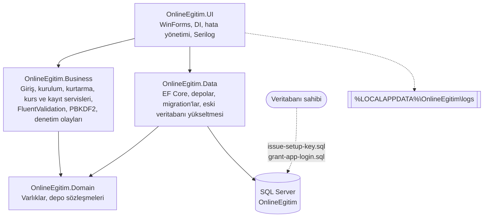

# 🎓 Online Eğitim - Online Eğitim Platformu (C# & SQL Server)

🇬🇧 [English](README.md) · 🇹🇷 **Türkçe**

.NET 10 ve SQL Server ile geliştirilmiş, öğrenci ve öğretmen için ayrı panelleri olan bir Windows Forms uygulaması:
öğrenciler kayıt olur, kursları inceler, kurslara katılır ve notlarını okur; öğretmenler kurs oluşturur, not ekler ve
kimlerin katıldığını görür. Kod Domain, Business, Data ve UI katmanlarına ayrılmıştır; veritabanı erişimi EF Core ile
yapılır, veritabanı açılışta otomatik oluşturulur ve güncellenir.

> Uygulamanın arayüzü Türkçedir. Aşağıda ekran ve düğme adları Türkçe etiketleriyle, ardından İngilizce
> karşılıklarıyla verilmiştir, örneğin "Ders Seç" (Join Course).

---

## 📦 Özellikler

### Öğrenci paneli

- ✅ **Kayıt** ("Öğrenci Kayıt", Student Registration): ad, e-posta adresi ve 8-64 karakterlik şifre. Kullanılan bir
  ad veya e-posta adresi yeni bir kayıt gibi sonuçlanır; ekran birinin hesabı olup olmadığını söylemez.
- ✅ **Giriş** ("Öğrenci Girişi", Student Sign-in): ad ("İsim Soyisim") ve şifreyle.
- ✅ **Kurs listesi** ("Öğrenci Paneli", Student Panel): tüm kurslar, öğretmenleriyle.
- ✅ **Kursa katılma** ("Ders Seç", Join Course); bir kursa bir kez katılınır.
- ✅ **Kurs detayları** ("Kurs Detayları", Course Details): ad, konu, öğretmen ve öğrenci sayısı; notlar yalnızca
  öğrencinin katıldığı kurslarda. Öğrenciler diğer öğrencilerin adlarını hiçbir zaman görmez.
- ✅ **Kurslarım** ("Kurslarım", My Courses) ve notları ("Kurs Notları", Course Notes).

### Öğretmen paneli

- ✅ **Giriş** ("Öğretmen Giriş", Teacher Sign-in): ad ve şifreyle.
- ✅ **Yeni kurs** ("Yeni Kurs Ekle", Add Course): ad ve konu; kurs her zaman giriş yapan öğretmene aittir.
- ✅ **Notlar** ("Not Ekle", Add Note): çok satırlı notlar, yalnızca öğretmenin kendi kurslarına.
- ✅ **Kursun öğrencileri** ("Kayıtlı Öğrenciler", Enrolled Students), yalnızca öğretmenin kendi kurslarında.
- ✅ **Kurtarma kodu** ("Kurtarma Kodu Üret", Issue Recovery Code): öğretmenin kendi kurslarındaki şifresiz bir
  öğrenci için.

### Kurslar ve notlar

- ✅ Kurs adı en fazla 100, konu en fazla 200, not en fazla 500 karakter (notta satır sonu serbest), denetim
  karakteri yok; Türkçe mesajlı merkezi doğrulayıcılar.
- ✅ Olmayan bir kurs ile başkasının kursu aynı yanıtı alır ("Ders bulunamadı.", Course not found); kimlik numaraları
  yoklanamaz.

### Güvenlik

- ✅ Şifreler PBKDF2-HMAC-SHA256 özeti olarak saklanır (600.000 tekrar, rastgele tuz).
- ✅ 5 hatalı giriş hesabı 15 dakika kilitler; bilinmeyen, kilitli, şifresiz hesaplar ve yanlış şifre aynı yanıtı
  ve aynı denetim kodunu alır.
- ✅ Hazır hesap yoktur: boş veritabanı ilk kurulumu ("İlk Kurulum", First-run Setup) açar; aksi halde kurucu,
  yalnızca veritabanı sahibinin üretebildiği bir **kurulum anahtarına** ihtiyaç duyar (24 saat, tek kullanım).
- ✅ Eski uygulamanın şifresiz bıraktığı hesaplar için **kurtarma kodları** (24 saat, tek kullanım, özet olarak
  saklanır).
- ✅ Her servis çağrısı giriş yapan oturumun rolüne ve sahipliğine göre denetlenir.
- ✅ Kişisel veri içermeyen, anonim denetim kodlu günlük dosyaları; yazma düğmeleri işlem sürerken tekrarlanan
  tıklamaları yok sayar.

---

## 🖼️ Ekran Görüntüleri

Aşağıdaki görüntüler özgün uygulamanın ekranlarıdır; tasarım çalışması bunları yenileyecek.

| | |
|---|---|
| <br>**Öğrenci girişi** ("Öğrenci Girişi") | <br>**Öğrenci paneli** ("Öğrenci Paneli") |
| <br>**Kurs detayları** ("Kurs Detayları") | <br>**Kurslarım** ("Kurslarım") |
| <br>**Öğretmen girişi** ("Öğretmen Giriş") | <br>**Öğretmen paneli** ("Öğretmen Paneli") |

---

## 🔑 Yetki Matrisi

| İşlem | Öğrenci | Öğretmen |
|---|---|---|
| Hesap oluşturma | ✅ öğrenci hesabı, giriş ekranından | ❌ (ilk öğretmen kurulumdan gelir) |
| Giriş | ✅ ad + şifre | ✅ ad + şifre |
| Tüm kursları listeleme | ✅ | ❌ (kendi kurslarını görür) |
| Kursa katılma | ✅ yalnızca kendisi için | ❌ |
| Kurs detaylarını görme | ✅ tüm kurslar; notlar yalnızca katıldıklarında | ✅ yalnızca kendi kursları |
| Kurs oluşturma | ❌ | ✅ kendisine ait |
| Not ekleme | ❌ | ✅ kendi kurslarına |
| Kursa kimlerin katıldığını görme | ❌ (yalnızca sayı) | ✅ kendi kurslarında |
| Kurtarma kodu üretme | ❌ | ✅ kendi kurslarındaki şifresiz öğrenciler için |
| Kodla ilk şifre belirleme | ✅ kendi hesabı | ❌ |
| Kurulum anahtarıyla ilk şifre belirleme | ✅ yalnızca hiçbir derse kayıtlı değilken | ✅ şifreli öğretmen yokken |
| Başka hesapların verisini görme veya değiştirme | ❌ | ❌ |

---

## 🧰 Kullanılan Teknolojiler

| Alan | Kullanılan |
|---|---|
| Platform | .NET 10 (`net10.0-windows` arayüz, `net10.0` kütüphaneler) |
| Arayüz | Windows Forms |
| Veri erişimi | Entity Framework Core 10 (SQL Server sağlayıcısı) |
| Veritabanı | Microsoft SQL Server (Express yeterli) |
| Şifre özeti | PBKDF2-HMAC-SHA256 (`Rfc2898DeriveBytes.Pbkdf2`) |
| Doğrulama | FluentValidation |
| Yapılandırma / DI | Microsoft.Extensions.Configuration (JSON, user secrets, ortam), Microsoft.Extensions.DependencyInjection |
| Günlük | Serilog (dosya hedefi, günlük dönen) |
| Test | xUnit v3, Moq, EF Core SQLite (bellek içi), isteğe bağlı gerçek SQL Server testleri |
| CI | GitHub Actions (`.github/workflows/ci.yml`) |

---

## 🗂️ Proje Yapısı

```text
OnlineEgitimPlatformu/
├── src/
│   ├── OnlineEgitim.Domain/     # Varlıklar (Student, Teacher, Course, CourseNote, Enrollment, SetupKey) ve depo sözleşmeleri
│   ├── OnlineEgitim.Business/   # Giriş, kurulum, kurtarma, kurs ve kayıt servisleri, Security/ (PBKDF2, kilit, kurulum anahtarı), Validation/ (FluentValidation), Auditing/
│   ├── OnlineEgitim.Data/       # EF Core DbContext, yapılandırmalar, Migrations/, eski veritabanı yükseltmesi, demo verisi, depolar
│   └── OnlineEgitim.UI/         # WinForms ekranları, Infrastructure/ (hatalar, günlük, iletişim kutuları, yazma koruması), Program.cs (bileşim kökü)
├── tests/
│   ├── OnlineEgitim.Business.Tests/  # Doğrulayıcılar, özet, kilit, rol, sahiplik, kurulum ve kurtarma (Moq)
│   ├── OnlineEgitim.Data.Tests/      # SQLite üzerinde servisler ve depolar; SQL Server'da yarışlar, kurulum anahtarı ve eski veritabanı yükseltmesi
│   └── OnlineEgitim.UI.Tests/        # Yapılandırma, hatalar, günlükler, iletişim kutuları, odak ve yazma korumaları (pencere açılmaz)
├── assets/                      # SVG kaynaklarıyla özgün logo, arka plan ve simge
├── docs/
│   ├── THREAT_MODEL.md          # Tehdit modeli (İngilizce)
│   ├── issue-setup-key.sql      # Kurulum anahtarı, veritabanı sahibi çalıştırır
│   └── grant-app-login.sql      # Uygulamanın kendi login'inin hakları
├── screenshots/                 # Özgün uygulamanın ekranları
├── .github/workflows/ci.yml     # Derleme, test ve sürüm iş akışı
├── CHANGELOG.md
└── onlineegitimplatformu.sln
```



Arayüz Data katmanına yalnızca açılışta bağımlılıkları kaydetmek için başvurur; formlar her çağrıda giriş yapan
oturumu alan Business servisleri üzerinden çalışır. Tüm veritabanı erişimi asenkron ve parametrelidir. Sağlayıcı DI
(`AddDataAccess`) üzerinden yapılandırılır, böylece testler SQLite bellek içi veritabanı kullanabilir.

---

## 🛠️ Kurulum ve Kullanım

### Gereksinimler

- .NET 10 SDK (Windows)
- SQL Server (örneğin SQL Server Express)

### 1. Yapılandırma

`OnlineEgitim` adlı bir bağlantı cümlesi verin. Aşağıdakilerin hepsi çalışır (sonrakiler öncekileri geçersiz kılar):

1. **`appsettings.json`**: `src/OnlineEgitim.UI/appsettings.example.json` dosyasını aynı klasörde `appsettings.json`
   adıyla kopyalayın ve `ConnectionStrings:OnlineEgitim` değerini (sunucu adını kendi ortamınıza göre) düzenleyin.
   `appsettings.json` git'e eklenmez.

   ```json
   {
     "ConnectionStrings": {
       "OnlineEgitim": "Server=localhost\\SQLEXPRESS;Database=OnlineEgitim;Trusted_Connection=True;TrustServerCertificate=True;"
     },
     "Seed": {
       "Demo": false
     }
   }
   ```

2. **User secrets**:

   ```powershell
   dotnet user-secrets set "ConnectionStrings:OnlineEgitim" "<bağlantı cümlesi>" --project src/OnlineEgitim.UI
   ```

3. **Ortam değişkeni** `ConnectionStrings__OnlineEgitim`.
4. **Ortam değişkeni** `EGITIM_CONNECTION` (en yüksek öncelik).

> JSON içinde `localhost\SQLEXPRESS` içindeki `\`, `\\` olarak yazılır. `TrustServerCertificate=True` yalnızca yerel
> geliştirme sunucusu içindir.

Bağlantı cümlesi bulunamazsa uygulama bu seçenekleri açıklayan Türkçe bir mesaj gösterip kapanır.

### 2. Çalıştırma ve migration'lar

```powershell
dotnet build -c Release
dotnet run --project src/OnlineEgitim.UI
```

Ya da `onlineegitimplatformu.sln` dosyasını Visual Studio ile açın. Veritabanı ilk açılışta oluşturulur ve bekleyen EF
Core migration'ları her açılışta uygulanır; elle `dotnet ef database update` gerekmez. İlk açılışı ve her şema
güncellemesinden sonraki açılışı veritabanı sahibinin bağlantısıyla yapın (bkz. adım 4).

Migration'larla çalışmak için:

```powershell
dotnet tool restore
dotnet ef migrations list --project src/OnlineEgitim.Data
dotnet ef migrations add <Ad> --project src/OnlineEgitim.Data --output-dir Persistence/Migrations
```

Tasarım zamanı fabrikası `EGITIM_CONNECTION` değişkenini okur, yoksa yerel SQL Server Express örneğini kullanır.

### 3. İlk açılış, ilk öğretmen ve kurulum anahtarı

- Hazır hesap yoktur. Veritabanı **tamamen boşsa** uygulama **İlk Kurulum** ekranıyla açılır ve ilk öğretmen
  anahtarsız oluşturulur.
- Kurulum anahtarı yalnızca **şifreyle giriş yapabilen hiçbir öğretmen yokken** kabul edilir: öğrencileri olan ama
  öğretmeni olmayan veritabanında ilk öğretmen (girişteki **İlk öğretmen kurulumu (kurulum anahtarı)** bağlantısı),
  yalnızca şifresiz öğretmenleri olan veritabanında bir öğretmene ilk şifre (**Şifresiz hesabı kurtar** →
  **Öğretmen (kurulum anahtarı)**) ve **yalnızca** hiçbir derse kayıtlı olmayan şifresiz bir öğrenciye ilk şifre (aynı
  ekranda kod yerine anahtar). Derse kayıtlı öğrenci için anahtar reddedilir ve kullanılmamış kalır; kurtarma kodunu
  o dersin öğretmeni üretir. Şifreli bir öğretmen varken anahtar kabul edilmez.
- Anahtarı **yalnızca veritabanı sahibi** (db_owner veya DBA) üretir:

  ```powershell
  sqlcmd -S <sunucu> -d <veritabanı> -E -i docs\issue-setup-key.sql
  ```

  Betik `CRYPT_GEN_RANDOM` ile 128 bitlik anahtarı bir kez gösterir (32 onaltılık karakter), veritabanına yalnızca
  SHA-256 özetini yazar; anahtar **24 saat** geçerlidir ve **bir kez** kullanılır. `@RevokeUnusedKeys = 1` önceki
  kullanılmamış anahtarları iptal eder. Uygulama anahtar üretemez.
- Anahtar hesap değişikliğiyle aynı veritabanı işleminde tüketilir: yazma başarısız olursa anahtar yanmaz; tüketilen
  anahtar başka bir Windows profilinden veya bilgisayardan yeniden kullanılamaz. Süre, anahtar tüketilirken
  veritabanının saatine göre yeniden denetlenir; istek kilit beklerken süresi dolan anahtar reddedilir.
- Yanlış, süresi dolmuş veya kullanılmış bir anahtar kurucunun anahtarını kilitlemez veya iptal etmez; böyle bir ret
  kısa, sabit bir beklemeyle döner. Anahtarı denetlemeyen retler (şifreli öğretmen var, alan eksik) hemen döner.
  Anahtar günlüğe veya açık metin olarak veritabanına yazılmaz.
- `EGITIM_SETUP_KEY` ortam değişkeni yalnızca formdaki anahtar alanını doldurur; değer veritabanındaki kayda karşı
  yazılmış bir anahtar gibi doğrulanır, tek başına yetki vermez. Anahtar değilse (tire ve boşluklar atıldıktan sonra 32
  onaltılık karakter değilse) form bir yapılandırma uyarısı gösterir.

### 4. Uygulamanın kendi login'i

İlk açılışı (migration'ları) veritabanı sahibinin bağlantısıyla yapın, sonra uygulamayı ayrı bir login'e geçirin.
`docs/grant-app-login.sql` bu login'e hesap ve ders tablolarında okuma/yazma, `KurulumAnahtarlari` tablosunda ise
yalnızca `SELECT` ve `Tuketildi`/`TuketimTarihi` sütunlarında `UPDATE` hakkı verir; anahtar eklemek, silmek veya
özetini ya da son kullanma zamanını değiştirmek reddedilir.

- Betik yalnızca hak verir; rol üyeliklerini **kaldırmaz**. Uygulamanın login'i `db_owner` veya `sysadmin` olmamalı ve
  veritabanının sahibi olmamalıdır: böyle bir login kendi kurulum anahtarını yazabilir.
- Bekleyen migration'lar bu haklardan fazlasını ister. Her şema güncellemesini önce sahibin bağlantısıyla uygulayın,
  sonra kısıtlı login'e dönün.

### 5. Şifresiz hesapların kurtarılması

Eski uygulamanın şifresiz bıraktığı hesaplar boş veya herhangi bir şifreyle giriş yapamaz. İlk şifreleri, hesap
kimliği ve ders kayıtları korunarak şöyle belirlenir:

- **Öğrenci:** Öğretmen panelindeki **Kurtarma Kodu Üret**, yalnızca o öğretmenin kendi derslerinden birine kayıtlı
  öğrenci için tek kullanımlık, 24 saat geçerli bir kod üretir (veritabanında yalnızca özeti tutulur). Başka
  öğretmenin öğrencisi veya derssiz öğrenci için istek, öğrenci yokmuş gibi reddedilir. Öğrenci giriş ekranındaki
  **Şifresiz hesabı kurtar** bağlantısında adını, kodu ve yeni şifresini girer. Hatalı kodlar giriş kilidine sayılır.
- **Hiçbir derse kayıtlı olmayan öğrenci:** şifreli öğretmen yokken kod alanına kurulum anahtarı.
- **Öğretmen:** aynı ekranda **Öğretmen (kurulum anahtarı)** seçilir; kurulum anahtarıyla bir kez şifre belirlenir.

### 6. Özgün veritabanının yükseltilmesi

Özgün uygulamanın oluşturduğu veritabanı ilk açılışta satırları ve kimlikleri korunarak yerinde yükseltilir. Kimliği
belirsiz kayıtlar (eksik, boşluklu veya yinelenen ad/e-posta, `OgrenciID` ve `DersID` dışında sütun içeren kayıt
anahtarı, mükerrer ders kaydı) yükseltmeyi hiçbir değişiklik yapmadan durdurur; hata penceresi ve günlük yalnızca sorun
türünü ve sayısını gösterir. Kayıtları düzeltip uygulamayı yeniden başlatın. Özgün uygulamanın açık metin şifreleri her
hesabın bir sonraki başarılı girişinde özetle değiştirilir. Bu sürümle ilk açılıştan önce yedek alın ve yedeği koruyun:
o açık metin şifreleri içerir.

### 7. Demo modu

Demo modu açıkça açılmadıkça kapalıdır: `EGITIM_DEMO=1` ortam değişkeni veya `"Seed": { "Demo": true }` ayarı. Yalnızca
o zaman ve yalnızca veritabanında henüz hiç hesap veya kurs yokken açılışta uydurma hesaplar ve kurslar eklenir:

| Rol | Giriş adı (yalnızca demo modunda) | Şifre (yalnızca demo modunda) |
|---|---|---|
| Öğretmen | `Deniz Örnek` (Yazılım), `Ece Taslak` (Tasarım) | `Demo.Ogretmen1`, `Demo.Ogretmen2` |
| Öğrenci | `Mert Deneme`, `Selin Deneme` | `Demo.Ogrenci1`, `Demo.Ogrenci2` |

Gerçek veri içeren bir veritabanında demo modunu asla açmayın.

### 8. Günlükler

Günlükler `%LOCALAPPDATA%\OnlineEgitim\logs\onlineegitim-YYYYMMDD.log` dosyalarına, gün başına bir dosya olarak yazılır.
30 günden eski tarihli dosyalar silinir ve en fazla 30 dosya saklanır. Hata kayıtları yalnızca istisna türlerini,
HResult kodlarını ve yığın izindeki yöntem adlarını içerir (dosya yolu yok); reddedilen işlemler yalnızca istisna
türünü yazar. Denetim kayıtları sabit bir kod ve rolden oluşur, örneğin:

```text
2026-11-19 10:42:07.118 +03:00 [INF] Audit auth.sign_in.failed student
2026-11-19 10:42:31.502 +03:00 [INF] Audit auth.sign_in.succeeded student
2026-11-19 10:58:12.034 +03:00 [INF] Audit course.note.added teacher
```

Adlar, e-posta adresleri, şifreler, kurtarma kodları, kurulum anahtarları, not içerikleri ve istisna mesajları
günlüğe hiçbir zaman yazılmaz.

---

## 🔐 Güvenlik

Tehdit modeli için [docs/THREAT_MODEL.md](docs/THREAT_MODEL.md) dosyasına bakın.

- Şifreler PBKDF2 ile özetlenir; saklama biçimi kendi sütununda tutulur, böylece bir değer hiçbir zaman başka bir
  biçimde okunmaz. Özgün uygulamanın açık metin şifreleri bir sonraki başarılı girişte yükseltilir.
- Kilit sayaçları atomik olarak güncellenir ve başarılı giriş yalnızca hesap hâlâ kilitsizken yazılır; eşzamanlı
  denemeler yeni bir kilidi silemez.
- Rol ve sahiplik servislerde denetlenir ve veritabanı yazımlarında tekrarlanır; olmayan kurs ile başkasının kursu
  aynı yanıtı alır.
- Kurulum anahtarları yalnızca veritabanı sahibinden, kurtarma kodları yalnızca öğrencinin kendi öğretmeninden gelir.
- Bağlantı cümleleri depo dışında tutulur (`appsettings.json` yok sayılır; user secrets ve ortam değişkenleri
  desteklenir). Tüm sorgular EF Core üzerinden parametreli çalışır.
- Kullanıcılar yalnızca Türkçe mesajlar görür; ham istisna metni hiçbir zaman gösterilmez.

---

## 🧪 Test

### Elle test

1. Boş bir veritabanında **İlk Kurulum** ile ilk öğretmeni oluşturun; ikinci kurulum reddedilir.
2. Geçersiz bir e-posta adresi veya 7 karakterlik şifreyle öğrenci kaydı deneyin; sonra doğru kayıt olup giriş yapın.
3. Beş kez yanlış şifre girin: altıncı deneme doğru şifreyle bile aynı mesajla reddedilir, 15 dakika sonra yeniden
   çalışır.
4. Öğretmen olarak bir kurs oluşturup not ekleyin; öğrenci olarak kursa katılıp notu okuyun.
5. SQL Server'ı durdurun; anlaşılır bir Türkçe hata gösterildiğini ve günlük dosyasının yalnızca tür ve yöntem adları
   içerdiğini kontrol edin.

### Otomatik testler

```powershell
dotnet test -c Release
```

| Proje | Tür | Kapsam | Sonuç (`-c Release`) |
|---|---|---|---|
| `tests/OnlineEgitim.Business.Tests` | Birim | Doğrulayıcı sınırları ve mesaj sırası, PBKDF2 ve biçim yükseltmesi, kilit, tek tip retler ve denetim kodları, kurs, not ve kayıtlarda rol ve sahiplik, katı Moq taklitleriyle kurulum anahtarı ve kurtarma | 193 başarılı |
| `tests/OnlineEgitim.Data.Tests` | Entegrasyon | SQLite bellek içi veritabanında servisler ve depolar (kilit, özet yükseltmesi, sahiplik, kurtarma, reddedilen girdi); SQL Server'da ders kaydı, giriş, kurulum ve kurulum anahtarı yarışları, beklerken süresi dolan anahtar, uygulama login'inin hakları, eski veritabanı yükseltmesi ve kilidi | SQL Server ve `EGITIM_LEGACY_BACKUP` ile 61 başarılı (yedek olmadan 60 başarılı, 1 atlandı); SQL Server olmadan 42 başarılı, 19 atlandı |
| `tests/OnlineEgitim.UI.Tests` | Birim | Örnek yapılandırma, hata mesajları, günlük içeriği, saklama süresi ve dosyalar, iletişim kutusu yardımcısı, kilit açıldıktan sonra odak, yazma korumaları, en son yanıtın gösterilmesi, nötr marka | 58 başarılı |

SQL Server testleri `EGITIM_TEST_SQLSERVER` içindeki sunucuda (varsayılan: Windows kimlik doğrulamalı yerel SQL Express)
geçici veritabanları kullanır; `EGITIM_SKIP_SQL_TESTS=1` ayarlıysa veya sunucuya ulaşılamıyorsa atlanır. Geçici
veritabanları sonra silinir. Özgün veritabanının yedeğini geri yükleyen test yalnızca `EGITIM_LEGACY_BACKUP`, SQL Server
hizmetinin okuyabildiği bir `.bak` dosyasını gösterdiğinde çalışır.

```powershell
$env:EGITIM_SKIP_SQL_TESTS = "1"; dotnet test -c Release
```

SQLite'ta şema migration'lar yerine modelden oluşturulur. Arayüz testleri formları göstermeden oluşturur, her mesaj
kutusunun yerine geçer ve sırayla çalışır; hiçbir pencere açılmaz.

---

## 🚀 CI ve Sürüm

`.github/workflows/ci.yml`, `main` dalına gönderimlerde, çekme isteklerinde ve `v*` etiketlerinde çalışır (Windows,
.NET 10):

1. **Derleme:** `dotnet build -c Release`
2. **Test:** `dotnet test -c Release` (SQL Server testleri atlanır)
3. **Sürüm (yalnızca `v*` etiketlerinde):** etiket adı bir ortam değişkeniyle aktarılır ve `^v[A-Za-z0-9._-]+$` ile
   doğrulanır; ardından çerçeveye bağımlı win-x64 derlemesi yayımlanır ve README'ler, değişiklik günlükleri, tehdit
   modeli ve iki SQL betiğiyle birlikte `OnlineEgitim-<etiket>-win-x64.zip` iş akışı çıktısı olarak yüklenir.

Aynı derlemeyi yerelde almak için:

```powershell
dotnet publish src/OnlineEgitim.UI -c Release -r win-x64 --self-contained false -o ./publish
```

Hedef makinede .NET 10 Desktop Runtime gerekir. `appsettings.json` dosyasını `OnlineEgitim.exe` yanına koyun veya
`EGITIM_CONNECTION` değişkenini tanımlayın.

---

## 👨‍💻 Geliştirici Notları

- Sürüm geçmişi için [CHANGELOG.tr.md](CHANGELOG.tr.md) dosyasına bakın.
- `Program.cs` bileşim köküdür: yapılandırma, DI, günlük, denetim hedefi ve genel `ThreadException` /
  `UnhandledException` işleyicileri orada kurulur.
- İş kuralı ihlalleri `BusinessRuleException`, yetki ihlalleri `AccessDeniedException` fırlatır; ikisi de arayüzün
  uyarı olarak gösterdiği sabit Türkçe mesajlar taşır.
- Doğrulayıcılar `OnlineEgitim.Business/Validation` altındadır ve ilk hatada durur; kullanıcı her seferinde tek bir
  mesaj görür.
- Yeni yazma düğmeleri `ExclusiveOperation` üzerinden çalışmalı ve odağı `FocusAfterUnlock` ile taşımalıdır; seçime
  bağlı yüklemeler yalnızca en son yanıtın gösterilmesi için `RequestSequence` kullanmalı, listeyi koddan doldurmak
  kullanıcı seçimi sayılmamalıdır. Mesaj kutuları doğrudan `MessageBox` ile değil, `Dialogs` veya `IUserPrompts`
  üzerinden açılır.
- Denetim olayları (`IAuditLog`) yalnızca olay türü ve rol taşır; bunlara kimlik belirten veri eklemeyin.

---

**Not:** Bu proje eğitim amaçlı bir çalışmadır ve daha ileri düzey özelliklerle geliştirilmeye açıktır.
